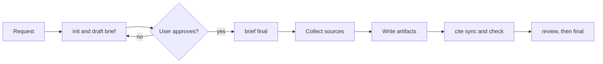
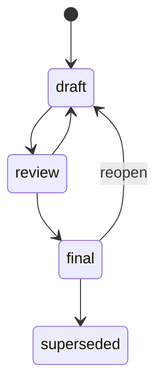

# Tech research

A research answers one technical question for this repository. It lives in
`docs/research/<slug>/` and holds typed artifacts. Each artifact is a
Markdown file with YAML front matter, built from a template of this skill.
Every claim cites a source, and every source records its author. A reader
can trace each fact to its origin.

`scripts/research.sh` does each action that must give the same result
every time. It creates the files, gives each source its ID and writes the
footnotes. It also moves the status and checks the folder. Never do these by hand, because a hand
edit drifts from the format that the check enforces. Run the tool from the
repository root:

```sh
R=.agents/skills/tech-research/scripts/research.sh
mise exec -- $R check
```

## Workflow



The diagram shows the one loop of the flow: the brief returns to draft until
the user approves it. Sources and artifacts come only after that approval.

1. **Init.** Pick a kebab-case slug without a date, such as
   `vector-db-choice`. Run `$R init <slug> --title <t> --author <a>`, or
   start from an issue (see [Start from an issue](#start-from-an-issue)). It
   creates `brief.md`, `report.md` and `sources.md`. Add
   `--depth quick|standard|deep` (default `standard`), and one
   `--artifact <type>` for each optional type that the question needs.
2. **Draft the brief.** Fill every section of `brief.md` from the request.
   Ask the user only about the fields that the request leaves open. Run
   `$R status <slug> brief.md review`.
3. **Get approval.** Show the brief to the user. On approval, run
   `$R status <slug> brief.md final`. If the user asks for changes, run
   `$R status <slug> brief.md draft`, edit, and ask again. Do not research
   before approval. After approval, only the user can change the brief.
   [Continue a research](#continue-a-research) explains how.
4. **Collect sources.** Read each source, then record it at once with
   `$R source add` (see [Sources](#sources)). The command prints the ID.
5. **Write the artifacts.** Replace each `<!-- fill: -->` comment with
   content. Cite with `[^S<n>]`. Add a file of an optional type with
   `$R add <slug> <type> --title <t> --author <a>`. Add `--name <n>` for
   a second file of the same type, named `<type>-<n>.md`.
6. **Sync and check.** Run `$R cite sync <slug>`, then `$R check <slug>`,
   and fix every problem.
7. **Finish.** Run `$R status <slug> <file> review` for each file. After
   the user accepts the file, run `$R status <slug> <file> final`. Run the
   `cold-reader` gate on your prose before you commit.

## Start from an issue

A user can request a research with a `type:research` issue or in chat.
The Research form in `.github/ISSUE_TEMPLATE/research.yml` contains the
fields of the brief, so the request and the brief stay the same.

Run `$R init <slug> --issue <n> --author <a>` in place of step 1. It reads
the issue with `gh` and refuses an issue without the `type:research`
label. It takes the title of the issue, unless you give `--title`. The
Depth field sets `depth`, and each checked type in the Artifacts field
goes into `artifacts`, so `init --issue` takes no `--depth` or
`--artifact`. The other fields fill these sections of the brief:

| Issue field | Brief section |
| --- | --- |
| Question | Question |
| Background | Background, with a link to the issue |
| In scope, Out of scope | Scope |
| Constraints | Constraints |
| Done when | Success criteria |
| Source policy | Source policy |

A field without a response keeps its `<!-- fill: -->` comment. Fill it
in step 2, like the first sentence under the title. Then get the
approval of the user as in step 3, also when the issue came from the user.

When the Slug field has a value, use it as `<slug>`, because `init`
refuses any other slug. When it is empty, pick a slug as in step 1. When
the slug is a research that exists, `init` refuses it: follow
[Continue a research](#continue-a-research). Open a
research issue with the `issue-authoring` skill. The PR of the research
closes the issue, and its commit type is `docs`.

## Continue a research

A user can bring new requirements for an existing research. Continue it in
its own folder. Do not start a new research for a follow-up.

1. **Find the slug.** The user names `<slug>` or `<slug>/<sub-slug>`. When
   the user names none, list the folders in `docs/research/` whose slug or
   title is close to the request, and ask the user which one to continue.
   Never guess the slug.
2. **Read the progress first.** Run `$R progress <slug>` before
   `$R reopen` and before any edit. It prints the status of each file, the
   open `<!-- fill: -->` placeholders, the number of sources and the
   sub-slugs.
3. **Reopen.** When the brief is `final`, run `$R reopen <slug>` before
   you add the new requirements. It moves the brief and every other file
   in `review` or `final` back to `draft`, `sources.md` too. `reopen`
   leaves these as they are:
   - superseded files keep their status, and the check doesn't need a
     final brief for them;
   - each source keeps its ID, and each `[^S<n>]` citation still points
     to the same source;
   - the sub-slugs of a parent and the parent of a sub-slug keep their
     status, because `reopen` changes only the folder of its slug.

   Only `reopen` moves a file from `final` to `draft`. When the brief is
   `draft` or `review`, skip this step: `reopen` refuses it. Move a brief
   in `review` back with `$R status <slug> brief.md draft`.
4. **Approve again.** Add the new requirements to the brief, then follow
   the [Workflow](#workflow) from step 2. The user approves the brief
   again before you research.

A sub-slug is a research of its own, so reopen it on its own.

## Sub-slugs

Split a large research into parts. A sub-slug is a full child research in
`docs/research/<slug>/<sub-slug>/`, with its own brief, report and
`sources.md`. A child cites only the sources in its own `sources.md`.

- **One level.** A child has no sub-slugs. The check fails for a folder
  below `<slug>/<sub-slug>/`.
- **The parent comes first.** `$R init <slug>/<sub-slug>` fails when
  `<slug>` does not exist. init accepts a parent in any status, and it
  doesn't change any file of the parent.
- **The parent links each child.** From the time the parent report is in
  `review`, the check fails when it has no link to `<sub-slug>/report.md`,
  such as the target `ci-cache/report.md` for the child `ci-cache`. The
  check applies it in `review`, `final` and `superseded`. When the parent
  report is in one of them, move it back to `draft` before you add the
  link: with `$R reopen <slug>` for a final brief, or with
  `$R status <slug> report.md draft` from `review`.

The commands `init`, `add`, `source add`, `cite sync`, `status`,
`check`, `progress` and `reopen` take `<slug>/<sub-slug>` as the slug. Each
child moves through the statuses on its own, and its problems do not block
a move in the parent.

## Artifact types

The set is closed. `references/types.yml` defines it, and
`references/templates/<type>.md` holds the template of each type. A
required type is in every research. A repeatable type may have more files,
named `<type>-<name>.md`. A diagram type needs at least one Mermaid
diagram from status `review` on.

| Type | Required | Repeatable | Diagram | Answers |
| --- | --- | --- | --- | --- |
| `brief` | yes | no | no | What do we ask, and what limits apply? |
| `report` | yes | no | yes | What is the answer, and on what findings does it rest? |
| `sources` | yes | no | no | Who said each fact, and where? |
| `comparison` | no | yes | yes | Which option ranks first against weighted criteria? |
| `recommendation` | no | yes | no | What do we decide, and what follows from it? |
| `tech-profile` | no | yes | yes | How does one technology work, and does it fit? |
| `experiment` | no | yes | yes | Does a spike confirm the claim? |

The brief lists the optional types of the research in `artifacts`. The
check fails for a file whose type the brief does not list. From the time
the report is in `review`, the check also fails for a listed type without
a file. Put risks, glossaries and similar notes in a section of the report.

The front matter of each file has the fields `type`, `title`, `status`,
`created`, `updated` and `authors`. The brief adds `depth` and
`artifacts`. A superseded file adds `superseded_by`. The check rejects any
other key. The first heading of each file is `# <title>`. The tool writes
all of these, so the dates and the quoting stay the same in every file.
When a required file is lost, `$R add <slug> <type>` creates it again.

## Brief

The brief is the templated input. Its sections are Question, Background,
Scope, Constraints, Success criteria and Source policy. `depth` sets the
effort:

- `quick`: at least 3 sources. Usually the report alone.
- `standard`: at least 5 sources, 2 of them primary.
- `deep`: at least 10 sources. Each key finding has 2 sources that agree.

The check does not count sources. The depth tells the user what to expect.

## Sources

`sources.md` is the register. Each entry is a `### S<n>` heading with a
table of fields. Only `$R source add` writes an entry:

```sh
mise exec -- $R source add <slug> --kind primary --author "PostgreSQL Global Development Group" \
  --title "PostgreSQL 17 release notes" --url https://www.postgresql.org/docs/17/release-17.html \
  --published 2024-09-26 --evidence "Version 17 adds incremental backups to pg_basebackup."
```

- `kind` is `primary` (official docs, a spec, a paper, source code),
  `secondary` (vendor blog, talk, book) or `tertiary` (forum, personal
  blog, AI summary).
- `author` is the person or organisation that wrote the source, not the
  site that hosts it.
- `evidence` paraphrases what the research takes from the source.
  Do not paste a quote, because Vale lints the register too.
- `published` is the date of the source, or `unknown`. The tool sets
  `accessed` to today.
- `archive` is optional. For a primary web source, add a Wayback Machine
  link when one exists. It keeps the citation usable when the URL stops
  working.

The tool gives the next free ID, and it prints the old ID when the URL is in
the register already. Never invent a source, a URL or an author. A fact
without a source is marked `(unverified)`.

## Citations

Cite a source with a footnote reference, such as `[^S2]`, right after the
claim. GitHub renders a footnote only when its definition is in the same
file. So `$R cite sync <slug>` writes the definitions at the end of each
file, each with a link to the entry in `sources.md`. Never edit these lines.
The check fails when they are stale, or when a file cites an ID that is not in
the register.

Each item of `## Key findings` in the report cites at least one primary
source, or ends with `(unverified)`. The check enforces this from status
`review` on.

## Diagrams

Prefer a diagram to text when it shows the structure. Mermaid flowcharts,
sequence, component and state diagrams, and quadrant charts fit most
research, and GitHub renders them. Put a prose paragraph right after each
diagram. It says what the diagram shows and why it matters, because a
diagram alone does not state the reasoning. The check fails for a diagram
without such a paragraph, in every status.

## Status



A file starts as `draft` and goes to `review` when it is complete. It goes
back to `draft` when the review finds a gap. After a successful
review, the file moves to `final`. When a newer research replaces it, it
moves to `superseded`.

Move one file only with `$R status <slug> <file> <status>`. The one
exception is `$R reopen <slug>`, which moves a whole research from
`final` back to `draft` (see [Continue a research](#continue-a-research)).
A move to
`review` or `final` runs the check, and it keeps the old status when the
file has a problem. Only a final brief lets other files move to `review`.
A move to `superseded` needs `--by <slug>` with the slug of the newer
research, in the form `<slug>` or `<slug>/<sub-slug>`. `$R status` refuses a move from `final` to `draft`.

These rules apply only to a file in `review`, `final` or `superseded`, so a
draft can be committed while it is incomplete:

- no `<!-- fill: -->` comment is left;
- a file of a diagram type contains a Mermaid diagram;
- each key finding cites a primary source or is `(unverified)`;
- each type that the brief lists has a file. This rule starts when the
  report moves to `review`.

## Check and enforcement

`$R check` checks every research and every sub-slug in `docs/research/`.
`$R check <slug>` checks one research and its sub-slugs, and
`$R check <slug>/<sub-slug>` checks one sub-slug. It prints one line for each problem and exits 1 when it
finds one. `mise run research:check` runs it for all folders. The
pre-commit hook `research-check` runs it when a commit changes
`docs/research/`, and CI runs it through `mise run check`. The hooks
`vale` and `knowledge-lint` lint the research prose and links like any
other Markdown file.

## Tests

`make -C .agents/skills/tech-research test` runs the four layers of the
`knowledge-curator` skill. Its drift layer runs these bats files:

- `tests/fixtures.bats` runs `$R check` against the fixtures.
  `tests/fixtures/good/` is a research root that must pass. It holds a
  final research with every type, a draft in progress and a quick research
  with a superseded report. The final research has a final sub-slug, and
  the draft has a draft sub-slug. Each folder `tests/fixtures/bad/<case>/` has a
  `defect.diff` that adds one defect to a copy of the good root. Its
  `expect.txt` lists every problem line that the check must print, with
  paths relative to the root. The test fails on a missing or an extra line.
- `tests/research.bats` tests the other commands on a copy of the good
  root, with a fixed `RESEARCH_TODAY`.
- `tests/drift.bats` compares the facts of this file with the script, the
  types, the templates, `mise.toml` and the hooks.

For a new check rule, add a bad case. Change a copy of the good root in a
throwaway git repository, and save `git diff` as `defect.diff`. Then write
`expect.txt` by hand. Never copy the expected lines from the output of the check, because
the test must catch a wrong message too. The defect stays in the diff, not
in a tracked Markdown file, because the `knowledge-lint` and `vale` hooks
lint every tracked Markdown file. A good fixture must pass these hooks too.
