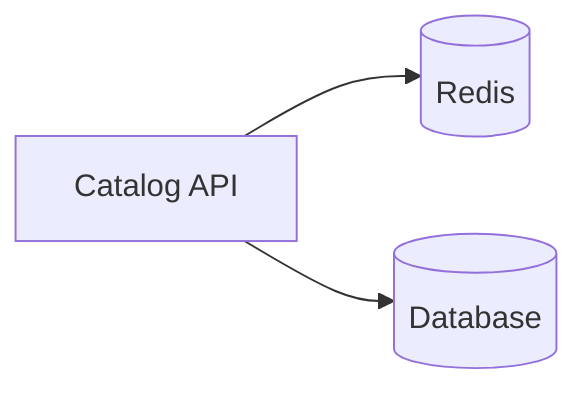

# Redis

<!-- fill: one sentence that says what the technology is and the version that this profile covers. -->

## Overview

Redis is an in-memory data store that Redis Ltd. maintains.[^S1]

## Architecture

The API reads from Redis first and falls back to the database on a miss.

## Maturity and community

<!-- fill: release history, adoption, maintainers, support channels and the health of the project. Cite each fact. -->

## Licence and cost

<!-- fill: the licence, the pricing model and any lock-in. -->

## Limits

<!-- fill: a list of known limits, such as scale, missing features, security issues and platform support. -->

## Fit for us

<!-- fill: how the technology meets each constraint of the brief. -->

[^S1]: [S1](sources.md#s1) Redis Ltd., Redis documentation.
