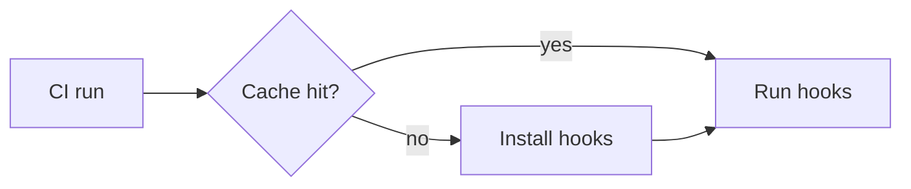

# Cache of hook environments in CI

Yes. CI can cache the one folder where pre-commit stores the hook
environments.

## Summary

The diagram shows that a cache hit skips the install step. Only a change
to the hook config makes CI install the hooks again.

## Key findings

- pre-commit keeps every hook environment in one cache folder.[^S1]
- The cache action restores a folder under a key in a later run.[^S2]

## Analysis

A key from the hash of the hook config changes only when a hook changes.

## Risks and open questions

- A stale cache can hide a broken install step.

## Conclusion

CI caches the pre-commit folder with the cache action.

[^S1]: [S1](sources.md#s1) pre-commit maintainers, pre-commit documentation: managing CI caches.
[^S2]: [S2](sources.md#s2) GitHub, actions/cache repository.
