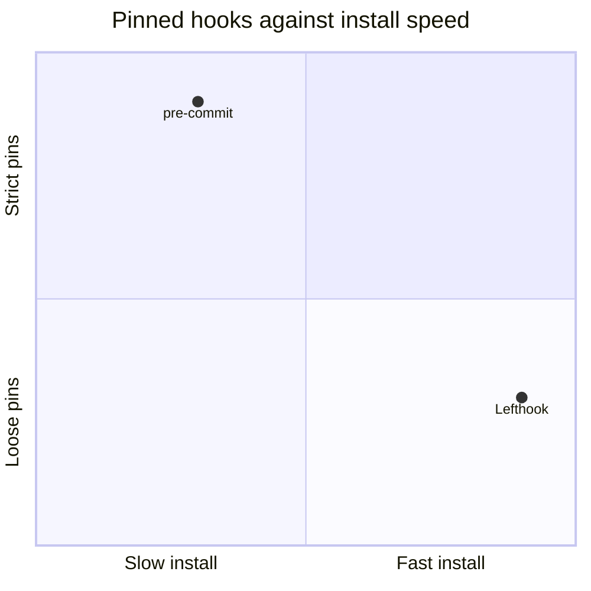

# pre-commit and Lefthook

This comparison ranks two hook runners for the hooks of this repository.

## Options

- pre-commit: a Python hook manager with pinned hook repositories.[^S1]
- Lefthook: a Go binary that runs hook commands.[^S2]

## Criteria

| Criterion | Weight | Measure |
| --- | --- | --- |
| Pinned hooks | 3 | The config pins each hook version. |
| Install time | 1 | Seconds from a clean clone. |

## Matrix

| Option | Pinned hooks | Install time |
| --- | --- | --- |
| pre-commit | 3 | 1 |
| Lefthook | 1 | 3 |

The chart puts pre-commit high on pinning and Lefthook high on install
speed. The weight of pinning decides the rank.

## Trade-offs

pre-commit gives up install speed. Lefthook gives up pinned hook
versions. The rank changes when install time gets the higher weight.

## Verdict

pre-commit ranks first, because pinned hooks have the highest weight.

[^S1]: [S1](sources.md#s1) pre-commit maintainers, pre-commit documentation.
[^S2]: [S2](sources.md#s2) Evil Martians, Lefthook repository.
