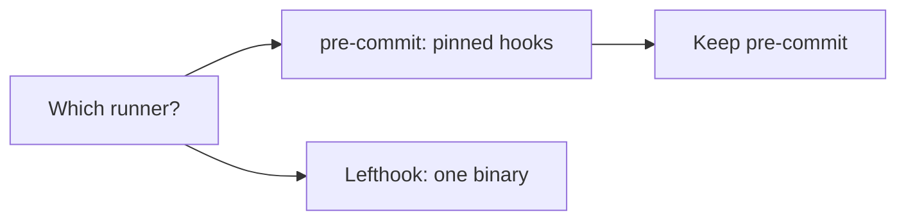

# Hook runner choice

Keep pre-commit. Lefthook installs faster, but pre-commit already pins
each hook, and the repository depends on that.

## Summary

The diagram shows the two options and the property that settles the
answer. Pinned hooks match the rule that every tool has a pinned version.

## Key findings

- pre-commit pins each hook to a git revision.[^S1]
- Lefthook is one Go binary with parallel commands.[^S2]
- pre-commit needs Python on the machine.[^S3]
- Most hook runs in this repository take less than two seconds (unverified).

## Analysis

The repository pins every tool through mise[^S4], so a runner without
pinned hooks breaks a rule. The speed gain of Lefthook is small for the
current set of hooks.

## Risks and open questions

- A slow hook can make the parallel runs of Lefthook more attractive later.

## Conclusion

The research picks pre-commit and gives the reason. The experiment
measures the install time of both runners.

[^S1]: [S1](sources.md#s1) pre-commit maintainers, pre-commit documentation.
[^S2]: [S2](sources.md#s2) Evil Martians, Lefthook repository.
[^S3]: [S3](sources.md#s3) pre-commit maintainers, pre-commit source code.
[^S4]: [S4](sources.md#s4) Jeff Dickey, mise documentation.
