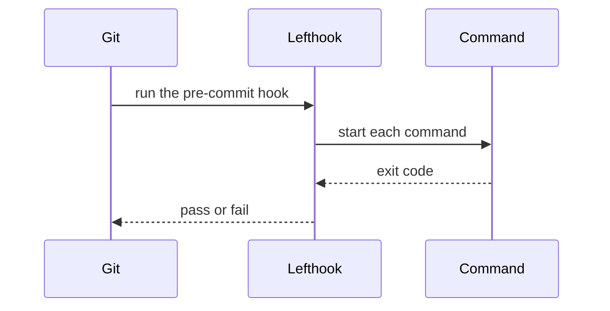

# Lefthook

Lefthook is a git hook runner. This profile covers its current major
version.

## Overview

Lefthook runs the commands of a git hook from one config file.[^S2]

## Architecture

Git calls Lefthook for a hook. Lefthook starts the commands of the hook
and returns one result to git.

## Maturity and community

Evil Martians maintain Lefthook in a public repository.[^S2]

## Licence and cost

Lefthook is free to use.

## Limits

- The config does not pin hook repositories, as pre-commit does.

## Fit for us

Lefthook meets the mise constraint, but not the pinned-hook rule.

[^S2]: [S2](sources.md#s2) Evil Martians, Lefthook repository.
