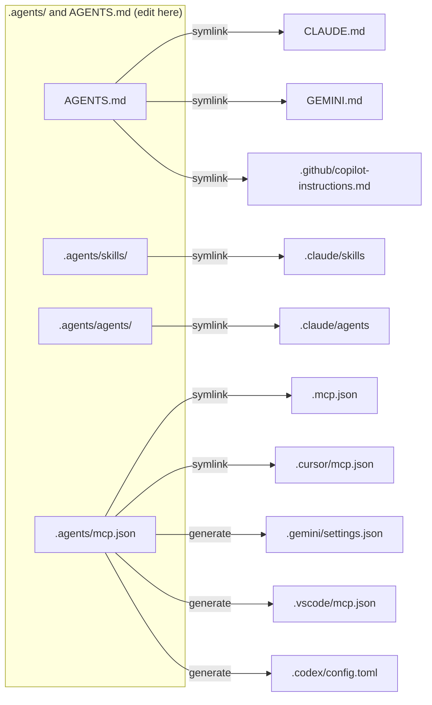

# Agentic setup

This repository supports several AI coding agents with one set of files.
Each tool reads its own paths. Symlinks and generated files map those paths to
one source of truth.

## Supported agents

| Agent | Instructions | Skills | Subagents | MCP config |
| --- | --- | --- | --- | --- |
| Claude Code | `CLAUDE.md` → `AGENTS.md` | `.claude/skills` → `.agents/skills` | `.claude/agents` → `.agents/agents` | `.mcp.json` → `.agents/mcp.json` |
| Codex | `AGENTS.md` | `.agents/skills` (native) | none | `.codex/config.toml` (generated) |
| Cursor | `AGENTS.md` | `.agents/skills` (native) | `.claude/agents` (compat) | `.cursor/mcp.json` → `.agents/mcp.json` |
| Gemini CLI | `GEMINI.md` → `AGENTS.md` | `.agents/skills` (native alias) | none | `.gemini/settings.json` (generated) |
| GitHub Copilot | `AGENTS.md`, `.github/copilot-instructions.md` → `AGENTS.md` | `.agents/skills` (native) | none | `.vscode/mcp.json` (generated) |

`→` means symlink. Nested `AGENTS.md` files get the same `CLAUDE.md` and
`GEMINI.md` symlinks beside them. `.agents/AGENTS.md` holds the rules for
changes to the agent configuration.



## Tooling

`scripts/agents-link.sh` creates and repairs every link and generated file.

- `mise run agents:link` fixes the layout. It moves a stray real `CLAUDE.md` or
  `GEMINI.md` to `AGENTS.md` when no `AGENTS.md` exists. Otherwise it stops and
  asks you to merge by hand.
- `mise run agents:check` only reads. It exits 1 on drift.

Generated files are committed, so agents work right after clone.

## Knowledge layer

These skills in `.agents/skills/` manage the instructions themselves:

- `knowledge-curator` decides where each rule and fact lives, triages new
  instructions, and holds the ledger of the root `AGENTS.md`.
- `decisionkit` runs closed decisions (yes/no, classification, scoring,
  ranking) with calibrated probabilities.
- `cold-reader` checks documentation quality with Vale, a cold reader and
  decisionkit.
- `library-docs` fetches current library docs through Context7.

Pre-commit hooks and the `agents-check` CI workflow run the same checks:
`mise run check`. The [knowledge-curator](../.agents/skills/knowledge-curator/SKILL.md)
skill lists each hook and the size limits of the `AGENTS.md` files. The LLM
test layers of the skills run only on demand with `mise run skills:test`.

## MCP server format

`.agents/mcp.json` uses the Claude Code / Cursor schema:

```json
{
  "mcpServers": {
    "local-tool": { "command": "npx", "args": ["-y", "some-mcp"], "env": { "TOKEN": "${TOKEN}" } },
    "remote-tool": { "type": "http", "url": "https://example.com/mcp", "headers": { "Authorization": "Bearer ${TOKEN}" } }
  }
}
```

The script translates it:

- Gemini CLI: remote `url` becomes `httpUrl`.
- VS Code / Copilot: top-level key `servers`. `type` is `stdio` or `http`.
- Codex: `[mcp_servers."<name>"]` tables. `headers` becomes `http_headers`.

Environment variable syntax differs per tool. Check each tool's docs before you
rely on `${VAR}` expansion.

## Known limits

- Codex loads `.codex/config.toml` only for trusted projects.
- Subagent formats differ (Codex uses TOML, Copilot uses `.github/agents/*.agent.md`).
  Only Claude Code and Cursor share `.agents/agents/` today.
- Slash-command formats differ between tools. Write skills instead.
- Symlinks need `core.symlinks=true` in git. On Windows, enable Developer Mode.

## Personal overrides

These files stay out of git (see `.gitignore`): `CLAUDE.local.md`,
`AGENTS.override.md`, `.claude/settings.local.json`, `mise.local.toml`.
Put personal environment variables, such as `DECISIONKIT_PROVIDER`, in the
`[env]` table of `mise.local.toml`.
