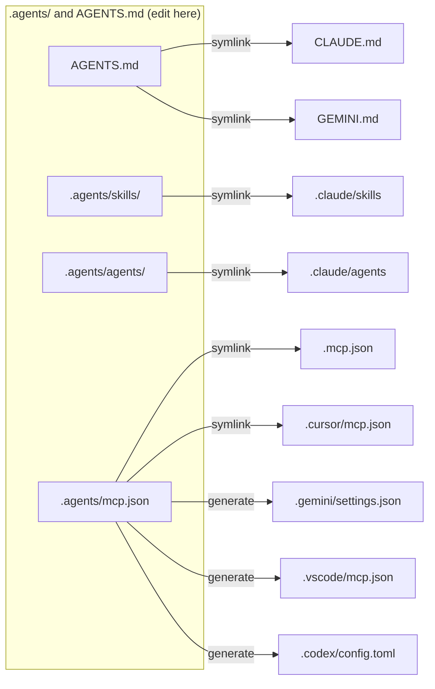

# Agentic setup

This repository supports several AI coding agents with one set of files.
Each tool reads its own paths. Symlinks and generated files map those paths to
one source of truth.

## Supported agents

| Agent | Instructions | Skills | Subagents | MCP config |
| --- | --- | --- | --- | --- |
| Claude Code | `CLAUDE.md` → `AGENTS.md` | `.claude/skills` → `.agents/skills` | `.claude/agents` → `.agents/agents` | `.mcp.json` → `.agents/mcp.json` |
| Codex | `AGENTS.md` | `.agents/skills` (native) | none | `.codex/config.toml` (generated) |
| Cursor | `AGENTS.md` | `.agents/skills` (native) | `.claude/agents` (compat) | `.cursor/mcp.json` → `.agents/mcp.json` |
| Gemini CLI | `GEMINI.md` → `AGENTS.md` | `.agents/skills` (native alias) | none | `.gemini/settings.json` (generated) |
| GitHub Copilot | `AGENTS.md` | `.agents/skills` (native) | none | `.vscode/mcp.json` (generated), repo settings for the cloud agent |

`→` means symlink. Nested `AGENTS.md` files get the same `CLAUDE.md` and
`GEMINI.md` symlinks beside them. `.agents/AGENTS.md` holds the rules for
changes to the agent configuration.



## Tooling

`scripts/agents-link.sh` creates and repairs every link and generated file.

- `mise run agents:link` fixes the layout. It moves a stray real `CLAUDE.md` or
  `GEMINI.md` to `AGENTS.md` when no `AGENTS.md` exists. Otherwise it stops and
  asks you to merge by hand.
- `mise run agents:check` only reads. It exits 1 on drift.
- `mise run agents:health` checks the agent environment of this machine:
  decisionkit and the pre-commit hook.

Generated files are committed, so agents work right after clone.

## Knowledge layer

These skills in `.agents/skills/` manage the instructions themselves:

- `knowledge-curator` decides where each rule and fact lives, triages new
  instructions, and holds the ledger of the root `AGENTS.md`.
- `decisionkit` runs closed decisions (yes/no, classification, scoring,
  ranking) with calibrated probabilities.
- `cold-reader` checks documentation quality with Vale, a cold reader and
  decisionkit.
- `library-docs` fetches current library docs through Context7.

Pre-commit hooks and the `agents-check` CI workflow run the same checks:
`mise run check`. The [knowledge-curator](../.agents/skills/knowledge-curator/SKILL.md)
skill lists each hook and the size limits of the `AGENTS.md` files. The LLM
test layers of the skills run only on demand with `mise run skills:test`.
The bats suites of `scripts/` run in the `scripts-test` pre-commit hook and
in the `scripts-test` CI workflow, not in `mise run check`.
[tests/AGENTS.md](../tests/AGENTS.md) gives their rules.

## MCP server format

`.agents/mcp.json` uses the Claude Code / Cursor schema:

```json
{
  "mcpServers": {
    "local-tool": { "command": "npx", "args": ["-y", "some-mcp"], "env": { "TOKEN": "${TOKEN}" } },
    "remote-tool": { "type": "http", "url": "https://example.com/mcp", "headers": { "Authorization": "Bearer ${TOKEN}" } }
  }
}
```

The script translates it:

- Gemini CLI: remote `url` becomes `httpUrl`.
- VS Code / Copilot: top-level key `servers`. `type` is `stdio` or `http`.
- Codex: `[mcp_servers."<name>"]` tables. `headers` becomes `http_headers`.

Environment variable syntax differs per tool. Check each tool's docs before you
rely on `${VAR}` expansion.

## GitHub Copilot cloud agent

The Copilot cloud agent works on issues and pull requests in a GitHub
Actions runner. It reads `AGENTS.md` and `.agents/skills` like the local
agents. These files prepare its runner:

- `.github/workflows/copilot-setup-steps.yml` installs the tools of
  `mise.toml`, syncs the Vale styles and runs `mise run check` before the
  agent starts. If a step fails, Copilot skips the rest and starts anyway.
  The session log then shows the failed step.
- `.github/hooks/agents-check.json` runs `mise run check` when the agent
  tries to stop. On a failure, the agent gets the output and another turn.
  Pre-commit does not run on the commits of the agent, so this hook is its
  quality gate. The `agents-check` CI workflow stays as the backstop. The
  hook skips the suites of `scripts/`, so the `scripts-test` CI workflow
  is their only gate for a commit of the agent.
  Copilot CLI reads the same hook, so it runs the checks locally too.
- `.github/dependabot.yml` keeps the commit SHAs of the pinned actions up to
  date.

Copilot reads these files only from the default branch. A change takes
effect after merge.

The agent firewall blocks unknown hosts for the commands that the agent
runs. It does not block the setup steps. So the setup steps install every
tool. The agent then has no need for the mise download hosts.

### Settings on GitHub

Some settings exist only in the GitHub UI. A repository admin sets them
once:

1. **Agents secret** `DECISIONKIT_TYPESAFE_API_KEY`: the Jev (TypeSafe AI) key for
   decisionkit. Set it in Settings → Secrets and variables → Agents. The agent
   cannot read Actions secrets.
2. **Agents variable** `DECISIONKIT_PROVIDER` = `jev`. Same path. Cloud
   sandbox sessions get secrets only, so decisionkit has no provider there
   and fails.
3. **Firewall allowlist**: add `api.typesafe.ai`, so decisionkit reaches
   Jev. Set it in Settings → Copilot → Internet access, in the section for
   Copilot in the cloud.
4. **MCP servers**: the cloud agent ignores `.agents/mcp.json`. Paste this
   into Settings → Copilot → MCP servers:

   ```json
   {
     "mcpServers": {
       "context7": {
         "type": "http",
         "url": "https://mcp.context7.com/mcp",
         "tools": ["*"]
       }
     }
   }
   ```

   Copilot requires a `tools` list. Every Context7 tool only reads docs, so
   `*` is safe. The `library-docs` skill names the tools. Secrets for MCP
   servers need the `COPILOT_MCP_` prefix.

## Known limits

- When `mise run check` fails on the default branch, the `agentStop` hook
  blocks each Copilot session 3 times before it lets the agent stop. Only
  the failed setup step in the session log shows the cause.
- Codex loads `.codex/config.toml` only for trusted projects.
- Subagent formats differ (Codex uses TOML, Copilot uses `.github/agents/*.agent.md`).
  Only Claude Code and Cursor share `.agents/agents/` today.
- Slash-command formats differ between tools. Write skills instead.
- Symlinks need `core.symlinks=true` in git. On Windows, enable Developer Mode.

## Personal overrides

These files stay out of git (see `.gitignore`): `CLAUDE.local.md`,
`AGENTS.override.md`, `.claude/settings.local.json`, `mise.local.toml`.
Put personal environment variables, such as `DECISIONKIT_PROVIDER`, in the
`[env]` table of `mise.local.toml`.
