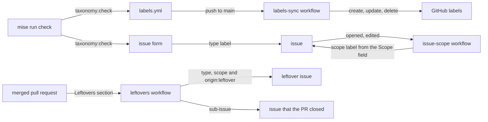

# Issues, pull requests and labels

Every issue in this repository has a type and a scope. Both are labels.
GitHub Issue Types exist only for organizations, and this repository
belongs to a user account.

## Files

| File | Role |
| --- | --- |
| `.github/labels.yml` | The only list of labels: `type:<x>` and `scope:<x>` for issues, `origin:<x>` for issues that a workflow opened, `pr:<x>` and `ci:<x>` flags for pull requests. |
| `.github/ISSUE_TEMPLATE/<type>.yml` | One issue form per type. It sets the type label and asks for the fields of that type. The `research` form asks for the fields of a research brief, which the [tech-research](../.agents/skills/tech-research/SKILL.md) skill reads. |
| `.github/ISSUE_TEMPLATE/config.yml` | Turns blank issues off. The web UI offers only the forms. |
| `.github/pull_request_template.md` | The body of every pull request, with the Requirements, Verify and Leftovers sections that the `pr-shepherd` check reads. |
| `.github/dependabot.yml` | Sets taxonomy labels on the Dependabot pull requests. |

## Automation

- **`labels-sync`** applies `labels.yml` after merge to `main`. It deletes
  every label that the file does not list. On a pull request it prints the
  plan only.
- **`issue-scope`** sets `scope:<x>` from the Scope field of the issue.
  An issue form can set only fixed labels. The form sets the type, and
  this workflow sets the scope.
- **`taxonomy:check`** fails pre-commit and CI when the Scope dropdown of
  a form differs from the scope labels, or when a type has no form.
- **`pr-shepherd`** checks each pull request: every issue item is carried
  over and ticked with evidence, and every review finding is triaged. The
  [pr-shepherd](../.agents/skills/pr-shepherd/SKILL.md) skill explains
  the rules.
- **`leftovers`** runs after each merge. It files each open item of the
  Leftovers section of the pull request as an issue with the labels
  `type:<x>`, `scope:<x>` and `origin:leftover`. It sets the scope label
  itself, because an issue that a workflow opens doesn't start other
  workflows. The issue is a sub-issue of the issue that the pull request
  closed. So a follow-up never hides in the Notes of a merged pull
  request.
- **`markers:check`** fails pre-commit and CI when a tracked file
  contains a task marker, such as a TODO comment. Follow-ups go to the
  Leftovers section instead.

## Tasks

- `mise run issue:new <type>` opens an issue from a form, with the fields
  as YAML on stdin. Agents use it, because `gh issue create` does not check
  the form fields.
- `mise run labels:sync --dry-run` prints the label changes for GitHub.
- `mise run taxonomy:check` runs the consistency check.
- `mise run markers:check` lists the task markers in tracked files.
- `mise run pr:shepherd leftovers <pr> --dry-run` prints the issues that
  the merge of a pull request will file.

The [issue-authoring](../.agents/skills/issue-authoring/SKILL.md) skill
describes the procedures for agents and people. It explains how to open an
issue or a pull request and how to change the labels.
