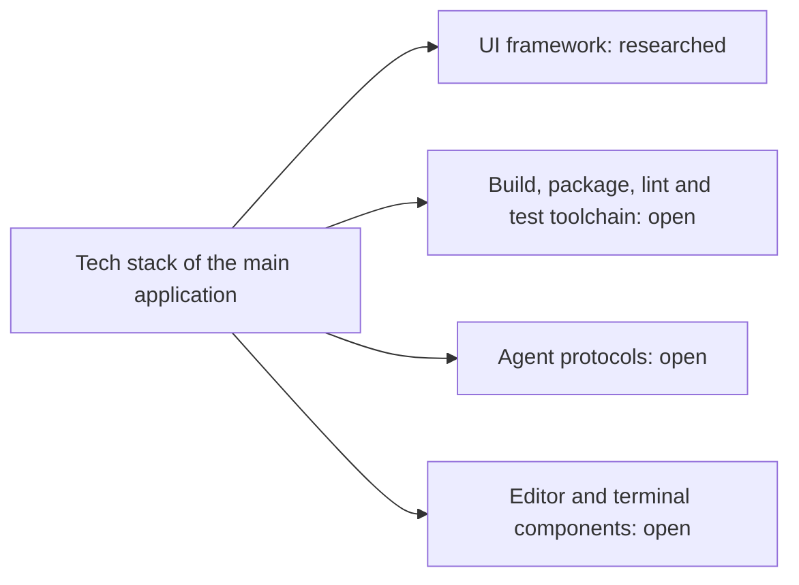

# Tech stack for the main application

The child research [UI framework for the main application](ui-framework/report.md) recommends Electron 45, React 19 and a reduced own kernel on dockview. It is the only part of the stack with a result so far.

## Summary

The UI framework is the only part with a child research and a recommendation. The toolchain, agent protocols and editor and terminal components have no research yet.

## Key findings

- Electron is the chosen runtime. The Electron project supports the latest three stable major versions[^S1], and renderers are sandboxed by default since version 20[^S4].
- React is the chosen view library. React gets backported security fixes for each affected major version[^S2].
- dockview is the chosen docking library. It offers floating groups, pop-out windows and layout serialization[^S3].

## Analysis

The child research ranks each choice in a weighted comparison. Electron scores 4.70 of 5 against 2.85 for Tauri 2. dockview scores 4.40 against 3.80 for FlexLayout. The own kernel scores 3.80 against 3.30 for Lumino with a small kernel. The [child report](ui-framework/report.md) gives the evidence.

## Risks and open questions

- The build, lint and test toolchain, the agent protocols and the editor and terminal components have no decision yet.
- This project must maintain the own kernel. Its proof of concept has 48,363 lines, and the child report recommends a reduced scope.

## Conclusion

- The report links each child research and states its outcome. The one child so far is [UI framework for the main application](ui-framework/report.md), and its outcome is Electron 45, React 19 and a reduced own kernel on dockview.
- The parts of the stack that still need a child research are the toolchain, agent protocols and editor and terminal components.

[^S1]: [S1](sources.md#s1) Electron project, Electron Releases.
[^S2]: [S2](sources.md#s2) React team, Versioning Policy.
[^S3]: [S3](sources.md#s3) dockview project, dockview README.
[^S4]: [S4](sources.md#s4) Electron project, Process Sandboxing.
