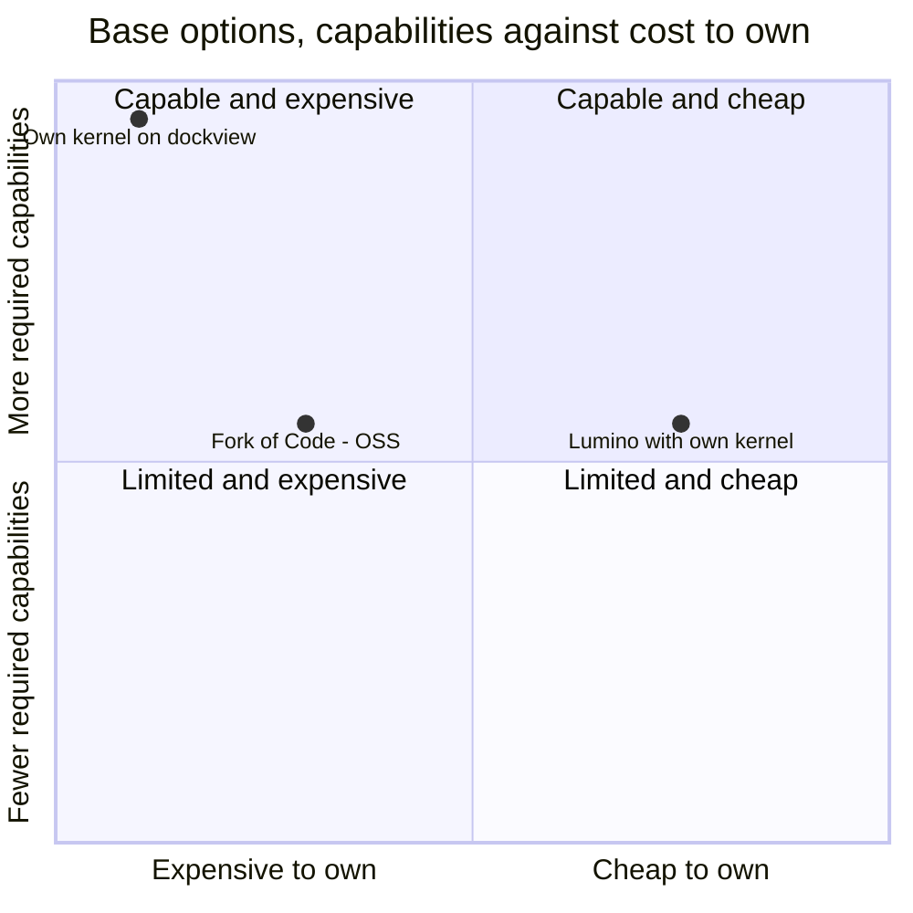

# Composite application framework comparison

This comparison ranks an own kernel on dockview, Lumino with a small own kernel, and a fork of Code - OSS as the base of the composable IDE.

## Options

- **Own kernel on dockview.** The [Tessera proof of concept](experiment-tessera-poc.md) is its worked example, on dockview[^S21] and React[^S35].
- **Lumino with a small own kernel.** Lumino gives plugins, commands and docking[^S15][^S16], and the [Lumino demo](experiment-lumino-demo.md) adds the rest.
- **Fork of Code - OSS.** The MIT-licensed core of VS Code[^S8] has layers and service injection[^S9].

These options failed a hard constraint of the brief:

- **Eclipse Theia.** Its licence is EPL-2.0 or GPL-2.0 with the Classpath exception[^S10][^S44], so it fails the licence rule. It stays a design reference for its contribution points and InversifyJS wiring[^S11].
- **Prism on Avalonia.** It is a .NET stack that cannot host React views, and it needs a Community licence with a revenue cap or a paid licence[^S18].
- **Eclipse RCP.** It uses the EPL-2.0 licence[^S55], so it fails the licence rule.
- **IntelliJ Platform.** Its UI framework is Swing, and embedded browsers are the exception[^S28].
- **Apache NetBeans.** It is a Java platform[^S54]. Hosting React views as first-class parts is unverified.
- **Piral and Backstage.** They target micro frontends[^S12] and extension trees for web apps[^S13]. Docking, workspaces and workitems would all be ours to build (unverified).

## Criteria

| Criterion | Weight | Measure |
| --- | --- | --- |
| Required capabilities | 30 | Dependency injection, plugins, composable UI, events, commands, workspaces and workitems, by evidence |
| Docking and IDE layout | 15 | Docking with floating groups and pop-out windows |
| React integration | 15 | React 19 views as first-class parts of the layout |
| SOLID and replaceable parts | 10 | The SOLID checks in the success criteria of the brief |
| Cost to build and maintain | 20 | The code that we must write and keep current |
| Upstream maintenance | 10 | Recent stable releases and active committers |

Each score runs from 1 (poor) to 5 (strong).

## Matrix

| Criterion (weight) | Own kernel on dockview | Lumino with own kernel | Fork of Code - OSS |
| --- | --- | --- | --- |
| Required capabilities (30) | 5 ([re-run](experiment-tessera-poc.md)) | 3 ([demo](experiment-lumino-demo.md)) | 3[^S9] |
| Docking and IDE layout (15) | 5[^S21] | 3[^S17] | 3 (unverified) |
| React integration (15) | 5 ([re-run](experiment-tessera-poc.md)) | 3[^S57] | 2 (unverified) |
| SOLID and replaceable parts (10) | 3 ([re-run](experiment-tessera-poc.md)) | 3 ([demo](experiment-lumino-demo.md)) | 4[^S9] |
| Cost to build and maintain (20) | 1 ([re-run](experiment-tessera-poc.md)) | 4 ([demo](experiment-lumino-demo.md)) | 2 (unverified) |
| Upstream maintenance (10) | 3[^S36][^S47] | 4[^S37][^S48] | 5[^S8][^S74] |
| **Weighted score** | **3.80** | **3.30** | **2.95** |

The own kernel scores 5 on capabilities and 1 on cost. Lumino with a small own kernel scores 3 and 4, and it lacks floating panels. The fork of Code - OSS scores 3 and 2, and it has the lowest score for React at 2.

## Trade-offs

- The own kernel has evidence for each required capability. Its proof of concept has 48,363 lines, and 23,929 of them are package source. We would maintain all of it. A design issue must reduce this scope before any product work.
- The own kernel also shows design debt, with a 1,509-line workbench class and 17 downcasts to concrete classes.
- Lumino gives docking, menus, a palette and key bindings without code of ours. The small layer of 1,155 lines has not been hardened, so the comparison with 48,363 lines overstates the advantage.
- A fork of Code - OSS gives a proven workbench. We would merge a monthly upstream[^S8], and its UI is not built on React (unverified).
- If cost to build weighs more than 30 of 100, taken from required capabilities, Lumino with a small own kernel moves to first place.
- If floating and pop-out panels are not needed, Lumino scores 5 instead of 3 on docking. Its total becomes 3.60, which is still below 3.80.
- If the project accepts EPL-2.0, Theia should re-enter this comparison.

## Verdict

The ranking is the own kernel on dockview (3.80), Lumino with a small own kernel (3.30) and the fork of Code - OSS (2.95). The own kernel takes first place because it alone has evidence for every required capability together with floating and pop-out docking. Its cost is the main risk, and the [recommendation](recommendation.md) responds to it.

[^S8]: [S8](sources.md#s8) Microsoft, Differences between the repository and Visual Studio Code.
[^S9]: [S9](sources.md#s9) Microsoft, Source Code Organization.
[^S10]: [S10](sources.md#s10) Eclipse Theia project, Theia README, License section.
[^S11]: [S11](sources.md#s11) Eclipse Theia project, Services and Contributions.
[^S12]: [S12](sources.md#s12) smapiot, Piral introduction.
[^S13]: [S13](sources.md#s13) Backstage project, Frontend Extensions.
[^S15]: [S15](sources.md#s15) Project Jupyter, Lumino application source.
[^S16]: [S16](sources.md#s16) Project Jupyter, Lumino plugin registry source.
[^S17]: [S17](sources.md#s17) Project Jupyter, Lumino DockPanel source.
[^S18]: [S18](sources.md#s18) Prism Library, Prism LICENSE file.
[^S21]: [S21](sources.md#s21) dockview project, dockview README.
[^S28]: [S28](sources.md#s28) JetBrains, Embedded Browser (JCEF).
[^S35]: [S35](sources.md#s35) React team, npm registry entry for react.
[^S36]: [S36](sources.md#s36) dockview project, npm registry entry for dockview-core.
[^S37]: [S37](sources.md#s37) Project Jupyter, npm registry entry for @lumino/widgets.
[^S44]: [S44](sources.md#s44) Eclipse Theia project, npm registry entry for @theia/core.
[^S47]: [S47](sources.md#s47) dockview project, GitHub commit list of dockview/dockview.
[^S48]: [S48](sources.md#s48) Project Jupyter, GitHub commit list of jupyterlab/lumino.
[^S54]: [S54](sources.md#s54) Apache NetBeans project, Apache NetBeans README.
[^S55]: [S55](sources.md#s55) Eclipse Platform project, Eclipse Platform UI README.
[^S57]: [S57](sources.md#s57) Project Jupyter, JupyterLab React guide.
[^S74]: [S74](sources.md#s74) Microsoft, GitHub commit list of microsoft/vscode.
