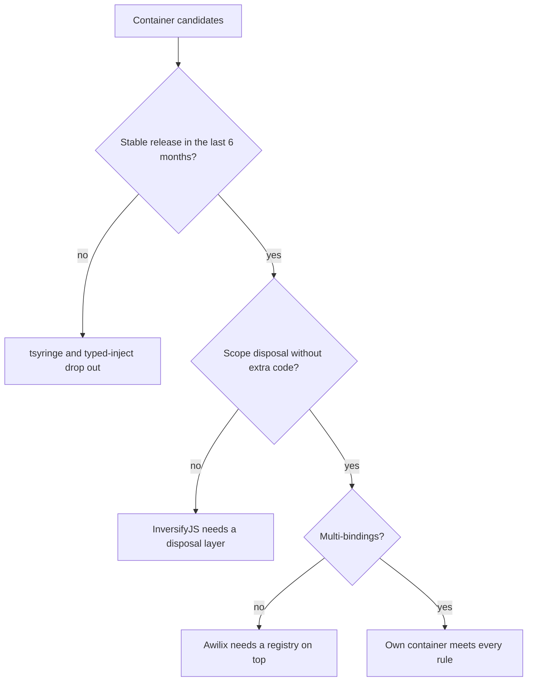

# Dependency injection comparison

This comparison ranks InversifyJS, tsyringe, Awilix, typed-inject and a small own container as the dependency injection layer of the application.

## Options

- **InversifyJS.** A container with hierarchies through a parent option[^S22]. Theia uses it[^S11].
- **tsyringe.** A decorator-based container from Microsoft with child containers[^S19].
- **Awilix.** A container without decorators, with scopes and a dispose call[^S20].
- **typed-inject.** A container that checks the dependency graph at compile time[^S31].
- **Own container.** The `@tessera/di` package in the [proof of concept](experiment-tessera-poc.md), with 832 lines of source.

## Criteria

| Criterion | Weight | Measure |
| --- | --- | --- |
| Hierarchical scopes | 25 | Child scopes for application, window, workitem and view |
| Multi-bindings | 10 | One token resolves to all of its providers |
| Deterministic disposal | 25 | Disposing a scope disposes its instances and its children |
| No required decorators | 10 | Plugin authors don't need a decorator or metadata toolchain |
| Maintenance | 30 | A stable release in the last 6 months and the number of active committers |

The first three criteria come directly from the success criteria of the brief. Each score runs from 1 (poor) to 5 (strong).

## Matrix

| Criterion (weight) | InversifyJS | tsyringe | Awilix | typed-inject | Own container |
| --- | --- | --- | --- | --- | --- |
| Hierarchical scopes (25) | 5[^S22] | 4[^S19] | 4[^S20] | 4[^S31] | 5 ([re-run](experiment-tessera-poc.md)) |
| Multi-bindings (10) | 5[^S22] | 5[^S19] | 2[^S20] | 2 (unverified) | 5 ([re-run](experiment-tessera-poc.md)) |
| Deterministic disposal (25) | 2[^S23] | 4[^S19] | 4[^S20] | 4[^S31] | 5 ([re-run](experiment-tessera-poc.md)) |
| No required decorators (10) | 2[^S70] | 1[^S19] | 5[^S20] | 5[^S31] | 5 ([re-run](experiment-tessera-poc.md)) |
| Maintenance (30) | 4[^S38][^S49] | 1[^S43][^S65] | 3[^S66][^S64] | 1[^S67] | 2 (we maintain it) |
| **Weighted score** | **3.65** | **2.90** | **3.60** | **3.00** | **4.10** |

Age removes tsyringe and typed-inject, with last releases in April 2025 and December 2024. InversifyJS lacks a dispose method, and Awilix lacks multi-bindings. Each of them needs extra code from us. The own container has the three required properties, and we must maintain it ourselves.

## Trade-offs

- InversifyJS had a release on 2026-11-07[^S38]. A child container subscribes to the caches of its parent, and the class has no dispose method[^S23]. It needs decorators and reflect-metadata[^S70]. Each workitem scope would need a disposal layer that we write.
- Awilix works without decorators and disposes its containers[^S20]. A multi-binding API is missing from its README, and the sample has two people[^S64].
- The own container has all the required properties and adds 832 lines that we must maintain. This choice depends on the framework choice in the [framework comparison](comparison-composite-framework.md).
- If maintenance outweighed the other criteria, InversifyJS would lead, and it would still need that disposal layer.

## Verdict

The ranking is the own container (4.10), InversifyJS (3.65), Awilix (3.60), typed-inject (3.00) and tsyringe (2.90). The own container takes first place because it alone gives hierarchical scopes, multi-bindings and deterministic disposal without decorators.

[^S11]: [S11](sources.md#s11) Eclipse Theia project, Services and Contributions.
[^S19]: [S19](sources.md#s19) Microsoft, tsyringe README.
[^S20]: [S20](sources.md#s20) Jeff Hansen, Awilix README.
[^S22]: [S22](sources.md#s22) InversifyJS project, Container API.
[^S23]: [S23](sources.md#s23) InversifyJS project, Container class source.
[^S31]: [S31](sources.md#s31) Nico Jansen, typed-inject README.
[^S38]: [S38](sources.md#s38) InversifyJS project, npm registry entry for inversify.
[^S43]: [S43](sources.md#s43) Microsoft, npm registry entry for tsyringe.
[^S49]: [S49](sources.md#s49) InversifyJS project, GitHub commit list of inversify/monorepo.
[^S64]: [S64](sources.md#s64) Jeff Hansen, GitHub commit list of jeffijoe/awilix.
[^S65]: [S65](sources.md#s65) Microsoft, GitHub commit list of microsoft/tsyringe.
[^S66]: [S66](sources.md#s66) Jeff Hansen, npm registry entry for awilix.
[^S67]: [S67](sources.md#s67) Nico Jansen, npm registry entry for typed-inject.
[^S70]: [S70](sources.md#s70) InversifyJS project, Getting started.
