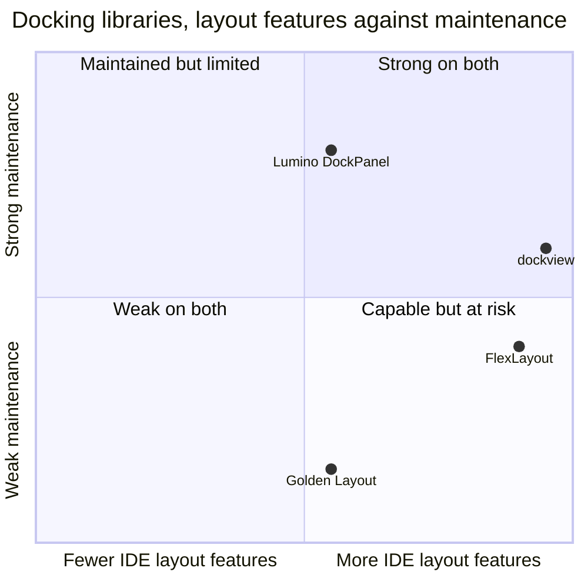

# Docking library comparison

This comparison ranks dockview, Lumino DockPanel, FlexLayout and Golden Layout as the docking layer of the composable IDE, and dockview ranks first with 4.40 of 5 points.

## Options

- **dockview.** A docking library with a zero-dependency TypeScript core[^S71]. It offers floating groups, pop-out windows and layout serialization[^S21].
- **Lumino DockPanel.** The docking widget of Lumino. It saves and restores layouts[^S17].
- **FlexLayout.** A layout manager for React with popout tabs[^S30].
- **Golden Layout.** A JavaScript layout manager with drag and drop[^S72].

## Criteria

| Criterion | Weight | Measure |
| --- | --- | --- |
| IDE layout features | 35 | Tab and group docking, floating groups and pop-out windows |
| Layout persistence | 20 | An API that saves and restores the full layout |
| Framework fit | 15 | The core runs without React and works with React 19 |
| Maintenance | 30 | A stable release in the last 6 months and the number of active committers |

Each score runs from 1 (poor) to 5 (strong). The weights follow the brief, which asks for a rich composable IDE on maintained technology.

## Matrix

| Criterion (weight) | dockview | Lumino DockPanel | FlexLayout | Golden Layout |
| --- | --- | --- | --- | --- |
| IDE layout features (35) | 5[^S21] | 3[^S17] | 5[^S30] | 3[^S72] |
| Layout persistence (20) | 5[^S21] | 5[^S17] | 5[^S30] | 5[^S72] |
| Framework fit (15) | 5[^S71] | 3[^S57] | 3[^S30] | 3 (unverified) |
| Maintenance (30) | 3[^S36][^S47] | 4[^S37][^S48] | 2[^S41][^S62] | 1[^S42][^S63] |
| **Weighted score** | **4.40** | **3.70** | **3.80** | **2.80** |

dockview scores 5 on layout features and 3 on maintenance. Lumino DockPanel scores 3 and 4, because it has no floating or pop-out panels. An IDE needs those panels, so dockview leads.

## Trade-offs

- `dockview-core` is an internal package, so a product should depend on `dockview` or `dockview-react`[^S71].
- dockview concentrates its work in one person, who made 261 of the 300 commits in the sample[^S47]. The sample shows 6 people, so it passes the maintenance rule of the brief. We still put it behind a replaceable adapter because of this concentration.
- Lumino DockPanel gives steady maintenance and gives up floating groups and pop-out windows[^S17].
- FlexLayout has the features and ties its core to React[^S30]. One person made every commit in the sample[^S62], and the version is still below 1.0[^S41].
- Golden Layout had its last release in 2022[^S42], and the sample has no commits[^S63]. It fails the maintenance rule.
- With a fixed weight for persistence and framework fit, Lumino passes dockview only when maintenance weighs more than about 53 of 100.

## Verdict

The ranking is dockview (4.40), FlexLayout (3.80), Lumino DockPanel (3.70) and Golden Layout (2.80). dockview takes first place because it is the only maintained option with floating groups, pop-out windows and a core that does not need React. The [Tessera re-run](experiment-tessera-poc.md) tests dockview behind an adapter in Chromium.

[^S17]: [S17](sources.md#s17) Project Jupyter, Lumino DockPanel source.
[^S21]: [S21](sources.md#s21) dockview project, dockview README.
[^S30]: [S30](sources.md#s30) Caplin, FlexLayout README.
[^S36]: [S36](sources.md#s36) dockview project, npm registry entry for dockview-core.
[^S37]: [S37](sources.md#s37) Project Jupyter, npm registry entry for @lumino/widgets.
[^S41]: [S41](sources.md#s41) Caplin, npm registry entry for flexlayout-react.
[^S42]: [S42](sources.md#s42) Golden Layout project, npm registry entry for golden-layout.
[^S47]: [S47](sources.md#s47) dockview project, GitHub commit list of dockview/dockview.
[^S48]: [S48](sources.md#s48) Project Jupyter, GitHub commit list of jupyterlab/lumino.
[^S57]: [S57](sources.md#s57) Project Jupyter, JupyterLab React guide.
[^S62]: [S62](sources.md#s62) Caplin, GitHub commit list of caplin/FlexLayout.
[^S63]: [S63](sources.md#s63) Golden Layout project, GitHub commit list of golden-layout/golden-layout.
[^S71]: [S71](sources.md#s71) dockview project, dockview-core package page.
[^S72]: [S72](sources.md#s72) Golden Layout project, Golden Layout documentation.
