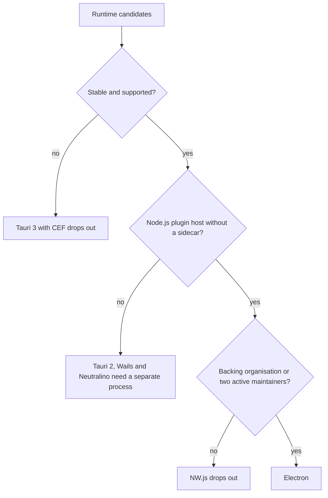

# Desktop runtime comparison

Electron ranks first as the desktop runtime with 4.70 of 5 points, ahead of Tauri 2 with 2.85. Tauri 3 with CEF, Wails, Neutralino and NW.js each failed a hard constraint of the brief.

## Options

- **Electron 45.** Chromium and Node.js in one runtime[^S34][^S2].
- **Tauri 2.** A Rust core that renders with the system webview of each platform[^S4][^S32].

These options failed a hard constraint of the brief:

- **Tauri 3 with CEF.** The CEF runtime exists only on the 3.0.0 alpha line[^S33]. The brief requires a supported stable version.
- **Wails.** It pairs a web frontend with a Go backend[^S52]. Plugins in TypeScript would need a separate Node.js process.
- **Neutralino.** It uses the browser library of the operating system[^S29], and it has no Node.js runtime for plugins.
- **NW.js.** It combines Chromium and Node.js[^S53]. One person made all 128 commits in the sample[^S59], so it needs an adapter and has no advantage over Electron.

## Criteria

| Criterion | Weight | Measure |
| --- | --- | --- |
| One rendering engine | 25 | The same web engine on macOS, Windows and Linux |
| TypeScript plugin host | 25 | A Node.js process model available without a sidecar |
| Security defaults | 15 | Sandboxed UI and a documented permission model |
| Maintenance | 20 | A support policy, a recent stable release and active committers |
| IDE precedent | 10 | A released IDE on the runtime |
| Footprint | 5 | The size of a packaged application |

The first two criteria decide most of the ranking, because the brief requires a rich IDE with plugins on three platforms. Each score runs from 1 (poor) to 5 (strong).

## Matrix

| Criterion (weight) | Electron 45 | Tauri 2 |
| --- | --- | --- |
| One rendering engine (25) | 5[^S1] | 2[^S4] |
| TypeScript plugin host (25) | 5[^S2] | 2[^S5] |
| Security defaults (15) | 4[^S3][^S56] | 4[^S6] |
| Maintenance (20) | 5[^S1][^S45] | 4[^S68][^S61] |
| IDE precedent (10) | 5[^S9] | 2 (unverified) |
| Footprint (5) | 2 ([experiment](experiment-electron-host.md)) | 5[^S6] |
| **Weighted score** | **4.70** | **2.85** |

The flowchart shows how the hard rules narrow the field. Stable support removes the CEF line. The plugin requirement removes the runtimes that have only system webviews. The maintenance rule removes NW.js. Electron passes each step.

## Trade-offs

- Electron gives one engine and Node.js, and it gives up install size and memory. It also needs an upgrade every 8 weeks to stay on a supported line[^S1].
- Tauri 2 gives a small package, because the webview stays outside the executable[^S6]. It gives up engine consistency, because the macOS webview updates only with the operating system[^S4].
- A stable Tauri release with a CEF runtime would change this ranking on the first criterion. The plugin host would still need a sidecar[^S5].
- If footprint were the top need, Tauri 2 would lead.

## Verdict

The ranking is Electron 45 (4.70) and Tauri 2 (2.85). Electron takes first place because it is the only stable option with one rendering engine and a Node.js process model.

[^S1]: [S1](sources.md#s1) Electron project, Electron Releases.
[^S2]: [S2](sources.md#s2) Electron project, utilityProcess API.
[^S3]: [S3](sources.md#s3) Electron project, Process Sandboxing.
[^S4]: [S4](sources.md#s4) Tauri project, Webview Versions.
[^S5]: [S5](sources.md#s5) Tauri project, Embedding External Binaries.
[^S6]: [S6](sources.md#s6) Tauri project, Process Model.
[^S9]: [S9](sources.md#s9) Microsoft, Source Code Organization.
[^S29]: [S29](sources.md#s29) Neutralinojs project, Neutralinojs introduction.
[^S32]: [S32](sources.md#s32) Tauri project, Tauri README.
[^S33]: [S33](sources.md#s33) Tauri project, tauri-runtime-cef on Tauri 3 alpha, issue 16481.
[^S34]: [S34](sources.md#s34) Electron project, npm registry entry for electron.
[^S45]: [S45](sources.md#s45) Electron project, GitHub commit list of electron/electron.
[^S52]: [S52](sources.md#s52) Wails project, Wails README.
[^S53]: [S53](sources.md#s53) NW.js project, NW.js README.
[^S56]: [S56](sources.md#s56) Electron project, Security checklist.
[^S59]: [S59](sources.md#s59) NW.js project, GitHub commit list of nwjs/nw.js.
[^S61]: [S61](sources.md#s61) Tauri project, GitHub commit list of tauri-apps/tauri.
[^S68]: [S68](sources.md#s68) Tauri project, npm registry entry for @tauri-apps/api.
