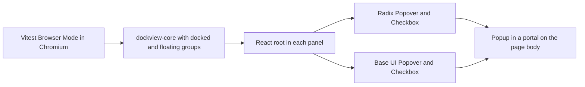
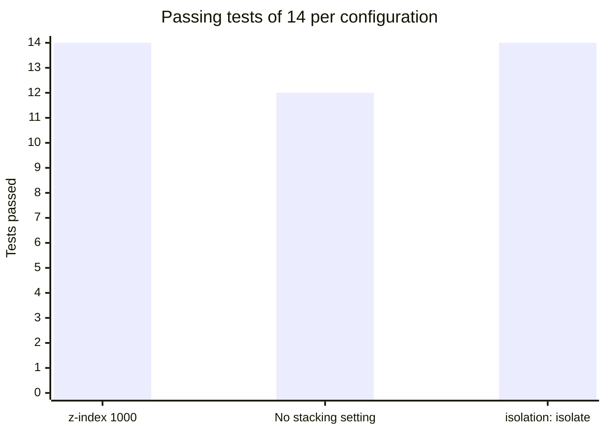

# Component libraries in dockview panels

This experiment tests whether React 19 views with Radix UI and Base UI work inside dockview panels, including a floating group.

## Hypothesis

Radix UI and Base UI work inside `dockview-core` panels with correct popup placement, focus handling and a clean unmount, with no extra settings.

A popup that dockview covers or clips proves this wrong. So does broken focus or Escape handling, and so does an unmount or panel move that throws or loses React state.

## Setup

The code is in `spikes/dockview-ui-kit`.

| Item | Value |
| --- | --- |
| Hardware | macOS on arm64 |
| Node | 26.12.1 |
| dockview-core | 8.8.3 |
| React | 19.3.1 |
| radix-ui | 1.8.1 |
| @base-ui/react | 1.9.0 |
| Vitest and Playwright | 5.1.0 and 1.65.0 |
| Browser | Chromium headless shell build 1243, from the Playwright cache |



The test mounts one React root in each panel. Each library renders a Popover and a Checkbox. The popups render through a portal, so they leave the panel and depend on the stacking order of the page.

## Method

Run these commands in `spikes/dockview-ui-kit`:

```bash
mise exec -- npm ci
mise exec -- npm run typecheck
mise exec -- npm test
VITE_POPUP_Z=off mise exec -- npm test
VITE_POPUP_Z=off VITE_DOCK_ISOLATE=on mise exec -- npm test
```

The second test run removes the stacking setting of the popup to show the baseline. The third run uses `isolation: isolate` on the dock host instead. Each test fails on any console error or page error. The popup check calls `document.elementFromPoint` at the centre of the popup.

## Results

| Configuration | Tests passed | Tests failed |
| --- | --- | --- |
| Popup with `z-index: 1000` | 14 | 0 |
| No stacking setting | 12 | 2 |
| `isolation: isolate` on the dock host | 14 | 0 |



The chart shows that only the configuration with no stacking setting loses tests. The 2 failures are the popover test in a floating group, once for each library. The floating layer of dockview has `z-index: 999`, so it covers a popup without its own stacking setting.

| Test | Radix UI | Base UI |
| --- | --- | --- |
| View renders in a panel with a non-zero size | pass | pass |
| Popover opens in a portal, and dockview does not cover it | pass | pass |
| Focus moves in, Escape closes, focus returns | pass | pass |
| Checkbox state is kept after a move to another group | pass | pass |
| Popover in a floating group, with a stacking setting | pass | pass |
| Tab switch keeps React state | pass | pass |
| Removing the panel and disposing the dock unmounts cleanly | pass | pass |

`dockview-core` calls itself an internal package, and its README names `dockview` and `dockview-react` as the packages to install[^S71]. The experiment reads its CSS out of the bundle, because `dockview-core` has no CSS file. A product should depend on a supported package instead.

The experiment did not test pop-out windows, drag and drop with an open popup, or other components such as menus and dialogs.

## Verdict

Refuted as stated, and confirmed with one setting. Both libraries behave the same in every test. A popup in a floating group needs a stacking setting. `isolation: isolate` on the dock host is the stronger fix, because it does not depend on a chosen number.

[^S71]: [S71](sources.md#s71) dockview project, dockview-core package page.
