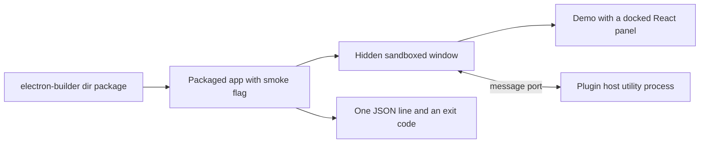

# Electron host for the demo

This experiment starts a packaged Electron 45 build of the React and dockview demo on macOS, Windows and Linux, with a sandboxed renderer and a separate plugin host.

## Hypothesis

A hardened Electron 45 window renders the Tessera demo, the renderer sends messages to a plugin host process directly over a message port, and a packaged build starts on each desktop platform.

Any of these results proves it wrong:

- The demo does not render in a sandboxed renderer.
- The round trip between renderer and plugin host fails.
- A packaged build does not start on one of the three platforms.

## Setup

The code is in `spikes/electron-host`. It copies the built demo of [spikes/tessera-poc](../../../../spikes/tessera-poc/README.md).

| Item | Value |
| --- | --- |
| Electron | 45.2.3 |
| Chromium | 156.0.8078.80 |
| Node.js inside Electron | 24.22.2 |
| electron-builder | 26.18.0 |
| Node.js for the build | 26.12.1 |
| Local machine | macOS on arm64 |
| CI runners | `windows-latest`, `ubuntu-latest`, `macos-latest` |



The smoke flag opens a hidden window and checks the running app from the inside. It prints one line of JSON and exits with 0 or 1, so a script can test a packaged build on any platform. The window settings are `contextIsolation: true`, `sandbox: true`, `nodeIntegration: false` and `webviewTag: false`, and the app loads from a custom `app://` scheme with a Content Security Policy header.

## Method

Run `mise exec -- npm ci` in `spikes/tessera-poc` first. Then run these commands in `spikes/electron-host`:

```bash
mise exec -- npm ci
mise exec -- npx install-electron
mise exec -- npm run build
mise exec -- npm run pack
mise exec -- npm run --silent smoke:packaged
mise exec -- npm run --silent bench
```

Electron 45 downloads its binary on demand, so `npx install-electron` must run after `npm ci`.

The check for the direct route blocks the JavaScript thread of the main process for 1.5 s and sends a ping during the block. Negative runs with `SPIKE_NEGATIVE` confirm that the checks can fail.

A temporary GitHub Actions workflow ran the same packaged smoke test on the three CI runners. Linux ran under `xvfb` with the Chromium setuid sandbox helper.

## Results

| Platform | Packaged smoke test | Docked React panel | Node.js absent from the page | Direct port route | Time to ready | Unpacked size |
| --- | --- | --- | --- | --- | --- | --- |
| Windows x64 | pass | pass | pass | pass | 774 ms | 371,157 KB |
| Linux x64 | pass | pass | pass | pass | 2,157 ms | 286,252 KB |
| macOS arm64 | pass | pass | pass | pass | 2,063 ms | 286,288 KB |

The CI run[^S75] gives these values, and each time comes from one run on a shared runner. Earlier CI attempts failed while they downloaded tools, because GitHub release downloads returned HTTP 504 errors. The final workflow retries those downloads.

The first CI run on Windows printed a diagnostic line on stdout. The app exited with status 0 and reported each check as passed, and the smoke runner rejected the extra line. The runner now selects the one JSON line.

On Windows and macOS the operating system sandboxes the renderer and leaves the plugin host outside the sandbox. Linux used the Chromium setuid sandbox helper, and the API does not report a sandbox value there.

Measurements on the local macOS arm64 machine, from a hidden window with one open panel:

| Measure | Value |
| --- | --- |
| Time to ready, 5 packaged runs | 291, 286, 277, 289 and 286 ms, median 286 ms |
| First launch after packaging | about 1.5 s |
| Main process memory | 164,816 KB |
| Renderer memory | 131,248 KB |
| Plugin host memory | 68,832 KB |
| Total memory of all processes | 501,168 KB |
| Packaged app size | 264 MB, of which the Electron framework is 251 MB |

Other results:

- The main world of the page has `typeof require` and `typeof process` equal to `undefined`.
- A ping during the 1.5 s block of the main process finished inside the block, with 0 control messages to the main process. So the traffic does not pass through the main process.
- `window.open` returned `null`, and the app blocked a foreign navigation.
- The plugin host is not sandboxed by the operating system. The renderer, GPU and network processes are.
- The Content Security Policy needed `style-src-elem 'self' 'unsafe-inline'`, because dockview and the React binding insert `<style>` elements at run time. The policy still blocks inline style attributes.
- One Content Security Policy report remains. Zod probes `Function('')` inside a `try` block, and the app logged 0 console errors.

## Verdict

Confirmed for Windows x64, Linux x64 and macOS arm64. A packaged, unsigned build renders the React and dockview demo in a sandboxed renderer on each of them, and the renderer sends messages to the plugin host directly.

The experiment does not cover signed builds, auto-update, Windows arm64, macOS x64 or real plugin workloads. It denies new windows, so it does not test pop-out windows.

[^S75]: [S75](sources.md#s75) aade maintainers, GitHub Actions run of the Electron host smoke test.
