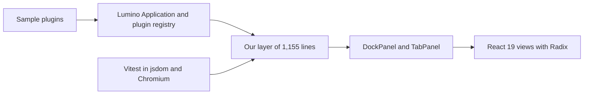
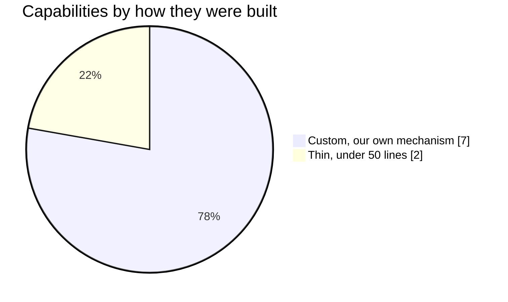

# The demo on Lumino

This experiment builds 9 capabilities on Lumino 2.10 with React 19 views and counts the lines of our own code that each capability needs. It found that 7 of the 9 need over 50 lines.

## Hypothesis

Lumino 2.10 provides each of the 9 capabilities natively or with under 50 lines of our code, and without a patch.

A patch or a private API proves this wrong. So does a result where more than half of the capabilities need over 50 lines of our code.

## Setup

The code is in `spikes/lumino-demo`.

| Item | Value |
| --- | --- |
| Hardware | macOS on arm64 |
| Node | 26.12.1, pinned in `mise.toml` |
| `@lumino/widgets` and `@lumino/application` | 2.10.0 and 2.4.11 |
| React | 19.3.1 |
| Radix | `@radix-ui/react-popover` 1.3.1, `@radix-ui/react-checkbox` 1.4.1 |
| Vitest and Playwright | 5.1.0 and 1.65.0 |
| Browser | Chromium headless shell build 1243, from the Playwright cache |



Sample plugins register with the native Lumino registry. Our layer adds the mechanisms that Lumino lacks. React views render inside native Lumino panels, and tests run in jsdom for logic and in Chromium for layout.

## Method

Run these commands in `spikes/lumino-demo`:

```bash
mise exec -- npm ci
mise exec -- npm run typecheck
mise exec -- npm test
```

Each capability has its own test file. A capability counts as `thin` under 50 lines of our code, and as `custom` above that. The line count is `wc -l`, with the code-only count where it changes the class.

## Results

| Measure | Value |
| --- | --- |
| Typecheck | Exit code 0 |
| Test files | 13 passed |
| Tests | 77 passed, 0 failed |
| Tests in jsdom and Chromium | 68 and 9 |
| Our mechanism | 1,155 lines |
| Sample plugins | 275 lines |
| Tests | 1,404 lines |
| Patches to Lumino or private API | 0 |

| # | Capability | Class | Our lines | Main gap in Lumino |
| --- | --- | --- | --- | --- |
| 1 | One view in two places | custom | 179 | A widget has one parent, so two widgets share one store. There is no React binding. |
| 2 | Plugin command in menu and palette | thin | 23, plus 63 shared | Context keys are missing. `Menu` reads enablement only when it opens. |
| 3 | Interceptors on commands and events | custom | 91 | `Application.commands` is read-only, so a veto does not cover commands run through it. |
| 4 | Plugin lifecycle | custom | 139 | Contributions before code, disposal tracking and rollback are ours. A second provider of a token silently replaces the first. |
| 5 | Persistence and migration | custom | 132 | `saveLayout` returns live widgets. `TabPanel` has no save or restore. |
| 6 | Scoped event bus | custom | 75 | Signals exist, and topics and a tree do not. |
| 7 | Dependency injection with scopes | custom | 138 | The token registry is flat. `DisposableSet` disposes in insertion order. |
| 8 | Workspaces | thin, borderline | 63, of which 47 are code | Named workspaces are missing. |
| 9 | Workitems | custom | 112 | Lumino has no equivalent. |



The chart shows the main result. Lumino gave a thin path for 2 of the 9 capabilities, and we wrote our own mechanism for the other 7. The mechanisms are small, and they are not hardened. Lumino still saved work. Docking, tab drag and drop, splitters, menus, the command palette, chord key bindings and the plugin registry needed none of our code.

Other results:

- A workitem can commit or discard its changes as one unit, by convention. Changes apply at once and register an undo step, and events wait for the commit. Other readers of the store see uncommitted state.
- Radix Popover and Checkbox worked inside docked panels in Chromium. The popover was not clipped, focus moved into it, and Escape closed it.
- `Application` has no stop or dispose call. `DockPanel.dispose` leaves its widgets undisposed, so the owner must close them.
- `Menu` discards the promise from command execution, so a vetoed or failing command from a menu becomes an unhandled rejection.
- Lumino has no floating or pop-out panels.

## Verdict

Refuted. No capability needed a patch or a private API, and 7 of the 9 capabilities needed over 50 lines of our own code, with 1,155 lines in total. Those lines contain scoped dependency injection, a scoped event bus and a plugin host. They also contain a layout serializer, a placement registry and workitems.

The experiment did not measure the cost of hardening those lines.
