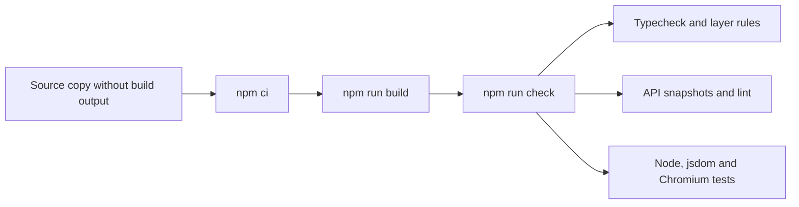
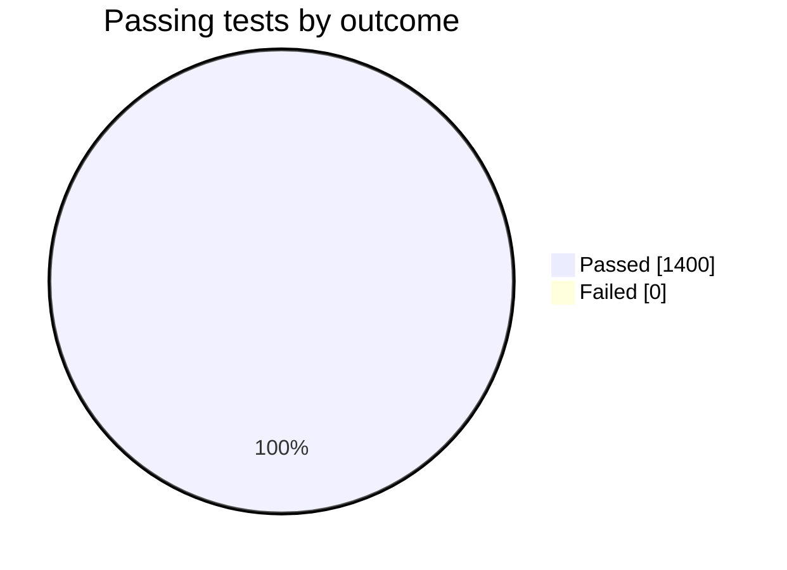

# Re-run of the Tessera proof of concept

This experiment tests whether the Tessera proof of concept passes its full gate from a clean copy on the pinned Node version.

## Hypothesis

`npm run check` of the Tessera proof of concept exits with 0 from a clean copy, and its tests cover dependency injection, plugins, composable UI, events, commands, workspaces and workitems.

A non-zero exit from `npm ci`, `npm run build` or `npm run check` proves this wrong.

## Setup

The code is in [spikes/tessera-poc](../../../../spikes/tessera-poc/README.md).

| Item | Value |
| --- | --- |
| Hardware | macOS on arm64 |
| Node | 26.12.1, pinned in `mise.toml` |
| npm | 11.20.0 |
| TypeScript | 7.0.2 |
| Vitest | 5.1.0 |
| React | 19.3.1 |
| Browser | Chromium headless shell build 1243 from the Playwright cache |



The flow starts from the source alone, so an old build cannot affect the result. The gate runs the static checks first and then every test project.

Playwright 1.65 expects Chromium build 1254, and this machine has build 1243. The configuration of the proof of concept selects the newest cached build.

Another Node.js comes first on `PATH` on this machine, and child processes of npm would use it. So the recorded run put the pinned Node.js first on `PATH`.

## Method

Run these commands in `spikes/tessera-poc`:

```bash
mise exec -- npm ci
mise exec -- npm run build
mise exec -- npm run check
```

The line count uses `find` over `.ts`, `.tsx`, `.mts`, `.mjs` and `.cjs` files, without `node_modules`, `dist`, `coverage`, `.vitest` and `test-fixtures`.

## Results

| Measure | Value |
| --- | --- |
| `npm run check` exit code | 0 |
| Test files | 148 passed |
| Tests | 1,400 passed, 0 failed |
| Test run duration | 21.43 s |
| Packages | 20 |
| Lines of code in total | 48,363 in 374 files |
| Lines in `packages/*/src` | 23,929 |
| Lines of the DI container source | 832 |
| Lines of `workbench-service.ts` | 1,509 |
| Downcasts to concrete `Default*` classes in `src` | 17 |



No test failed. The 1,400 tests cover 23,929 lines of package source.

A GitHub Actions run repeated the tests on three platforms, with the Chromium projects turned off[^S75]. That leaves 1,377 tests.

| Platform | Tests passed | Tests failed |
| --- | --- | --- |
| Linux x64 | 1,376 | 1 |
| macOS arm64 | 1,376 | 1 |
| Windows x64 | 1,366 | 11 |

One test failed on every platform. It expects a help text from oxlint that the GitHub annotation format leaves out, and the lint errors themselves did fire. Windows has 10 more failures. Of those, 9 are in the layer check tools, which fail on Windows file paths, and 1 is a test of 10,000 cycles that passed its 10 s limit.

The `check:docs` step skipped itself, because the design documents stay outside this repository. So the gate ran without its check of documented error codes and exports.

A workitem can delete its stored state when it ends, through `terminate({ discardState: true })`. The `transact` call batches writes and delays events until the function returns. If the function throws, the events are dropped and the writes stay. So a workitem can't commit or discard its changes as one unit.

## Verdict

Confirmed, with limits. The kernel installs, builds and passes its gate from a clean copy, and tests cover each required capability.

The experiment does not run the kernel inside Electron. The [Electron host experiment](experiment-electron-host.md) covers that gap.

These results count against SOLID. `workbench-service.ts` has 1,509 lines, which strains single responsibility. Seventeen downcasts to concrete classes weaken dependency inversion.

[^S75]: [S75](sources.md#s75) aade maintainers, GitHub Actions run of the Electron host smoke test.
