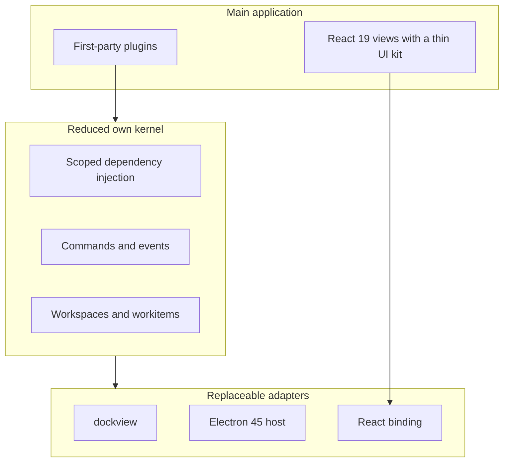
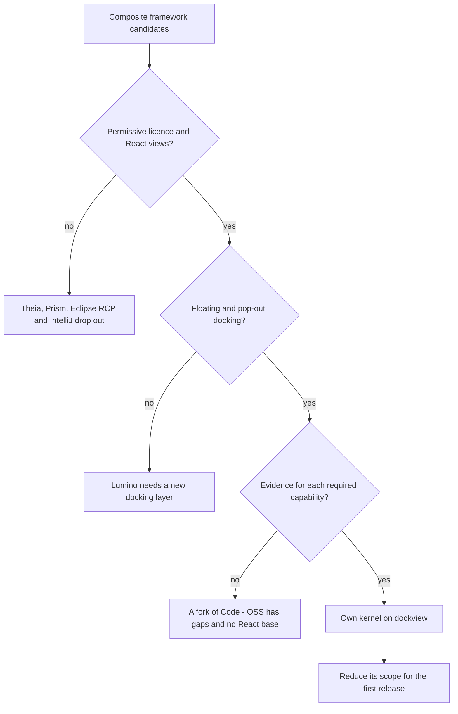

# UI framework for the main application

As the [recommendation](recommendation.md) states, the main application should run on Electron 45 with React 19 views and a reduced own kernel on dockview. The own kernel ranks first with 3.80 of 5 points in the [framework comparison](comparison-composite-framework.md), and maintaining its code is the main risk.

## Summary

The diagram shows the recommended stack as three layers. Plugins and views sit on a kernel that we write. The kernel calls dockview, Electron and React only through adapters, and we can replace each of them. The kernel layer is where the research finds both the required capabilities and the largest cost.

## Key findings

- Electron is the only stable runtime in the comparison with one rendering engine and a Node.js process model[^S1][^S2][^S75]. Tauri 2 renders with a different webview on each platform[^S4][^S32].
- A Chromium runtime for Tauri exists only as an alpha, and its crate has no stable version[^S33][^S76].
- Eclipse Theia fails the permissive licence rule, because its licence is EPL-2.0 or GPL-2.0 with the Classpath exception[^S10][^S44].
- dockview offers floating groups and pop-out windows[^S21][^S86][^S87]. Lumino has neither feature[^S17][^S88].
- One person made most of the commits to dockview, with 261 of 300 sampled commits and 3,508 contributions overall[^S47][^S77]. Its `dockview-core` package calls itself internal[^S71][^S78].
- Lumino gives plugins and commands natively[^S15][^S16], but the [Lumino demo](experiment-lumino-demo.md) needed our own mechanism for 7 of 9 capabilities.
- InversifyJS has no dispose method[^S23][^S22]. tsyringe had its last release in April 2025, and its commit sample has one commit[^S43][^S65]. A small own container fits the rules of the brief best, as the [DI comparison](comparison-di.md) shows.
- React 19.3.1 and Base UI 1.9.0 are current and MIT licensed[^S35][^S81][^S82][^S40][^S83][^S84]. Radix 1.8.1 is MIT licensed[^S39][^S85].
- Electron supports the latest three stable majors[^S1][^S80], and version 45.2.3 was published on 2026-11-04[^S34][^S79].
- A packaged Electron build started on Windows, Linux and macOS with a sandboxed renderer[^S75][^S3], as the [Electron host experiment](experiment-electron-host.md) shows.

## Analysis

The licence rule removes Theia, which the preliminary study named as the closest match for an IDE. That leaves two serious bases, which are Lumino with a small kernel of our own and a full own kernel on dockview.

Each question in the flowchart removes options that fail a requirement of the brief. The own kernel remains, and its proof of concept has 48,363 lines. A first release with first-party plugins needs far fewer.

The experiments gave these results:

- The Lumino demo refuted the idea that a thin layer is enough. Lumino saves the docking and menu work, and the concepts of the product are still ours to build.
- The Electron host closed the largest gap of the preliminary study. A packaged build now runs on three platforms.
- The UI kit experiment found a defect that the other experiments missed. A popup in a floating dock group is hidden unless the application sets a stacking rule.

The table maps each SOLID principle of the brief to its evidence in the proof of concept.

| Principle | Check | Result |
| --- | --- | --- |
| Single responsibility | Module and class boundaries | Partly met. There are 20 packages, and `workbench-service.ts` has 1,509 lines. |
| Open/closed | Contribution points | Met. Sample plugins add commands and views without changes to the kernel. |
| Liskov substitution | Adapter conformance suites | Met. Suites cover the docking adapter, reactive engine, storage, transport and view mounter. |
| Interface segregation | Narrow service contracts | Met. Plugins import one facade package. |
| Dependency inversion | Injected abstractions and a layer fence | Partly met. The fence has 32 rules and passes, and 17 downcasts to concrete classes remain. |

## Risks and open questions

- This project must maintain the 48,363 lines of the own kernel. The size of a reduced kernel is not measured yet.
- The experiment did not measure the hardening of the 1,155-line Lumino layer, so that number understates its cost.
- Pop-out windows were not tested under Electron.
- dockview depends mainly on one person[^S47].
- Electron needs an upgrade about every 8 weeks[^S1].
- Tessera and the Lumino demo can't guarantee that a workitem commits or discards its changes as one unit. A design issue should settle whether that is needed.
- The evidence for a fork of Code - OSS comes from documentation only, and several of its scores are unverified.
- The Chromium licence file needs a legal review before distribution[^S73].
- The CI run logs expire[^S75]. The tables in the experiments are the lasting record.

## Conclusion

| Success criterion | Answer |
| --- | --- |
| modern tech stack is found | Yes. Electron 45, React 19 and dockview 8 are current[^S34][^S35][^S36]. |
| is based on maintained technologies | Yes, with one caution. Each chosen component had a stable release in the last 6 months. dockview goes behind an adapter, because one person made most of its commits[^S47]. |
| supports cross-platform | Yes for Windows x64, Linux x64 and macOS arm64, by a packaged smoke test[^S75]. Windows arm64 and macOS x64 are unverified. |
| supports SOLID patterns | Partly. Open/closed, Liskov substitution and interface segregation are met. Single responsibility and dependency inversion have debt to fix. |
| supports dependency injection | Yes. The own container gives hierarchical scopes, multi-bindings and deterministic disposal, as the [re-run](experiment-tessera-poc.md) shows. |
| supports React and modern UI components | Yes. React 19 views with Radix UI and Base UI render in dockview panels, as the [UI kit experiment](experiment-dockview-ui-kit.md) shows. |
| Each option has a verdict for each required capability | Yes, in the [framework comparison](comparison-composite-framework.md) and the [Lumino demo](experiment-lumino-demo.md). The candidates don't guarantee commit or discard as one unit. |
| The comparison states what we must build and own | Yes, in the cost criterion of the [framework comparison](comparison-composite-framework.md). |
| Each experiment ends with a verdict | Yes. The [re-run](experiment-tessera-poc.md) and the [Electron host](experiment-electron-host.md) are confirmed, the [Lumino demo](experiment-lumino-demo.md) is refuted, and the [UI kit experiment](experiment-dockview-ui-kit.md) is refuted as stated and confirmed with one setting. |

The next step is a design issue that reduces the scope of the kernel for the first release.

[^S1]: [S1](sources.md#s1) Electron project, Electron Releases.
[^S2]: [S2](sources.md#s2) Electron project, utilityProcess API.
[^S3]: [S3](sources.md#s3) Electron project, Process Sandboxing.
[^S4]: [S4](sources.md#s4) Tauri project, Webview Versions.
[^S10]: [S10](sources.md#s10) Eclipse Theia project, Theia README, License section.
[^S15]: [S15](sources.md#s15) Project Jupyter, Lumino application source.
[^S16]: [S16](sources.md#s16) Project Jupyter, Lumino plugin registry source.
[^S17]: [S17](sources.md#s17) Project Jupyter, Lumino DockPanel source.
[^S21]: [S21](sources.md#s21) dockview project, dockview README.
[^S22]: [S22](sources.md#s22) InversifyJS project, Container API.
[^S23]: [S23](sources.md#s23) InversifyJS project, Container class source.
[^S32]: [S32](sources.md#s32) Tauri project, Tauri README.
[^S33]: [S33](sources.md#s33) Tauri project, tauri-runtime-cef on Tauri 3 alpha, issue 16481.
[^S34]: [S34](sources.md#s34) Electron project, npm registry entry for electron.
[^S35]: [S35](sources.md#s35) React team, npm registry entry for react.
[^S36]: [S36](sources.md#s36) dockview project, npm registry entry for dockview-core.
[^S39]: [S39](sources.md#s39) WorkOS, npm registry entry for radix-ui.
[^S40]: [S40](sources.md#s40) MUI, npm registry entry for @base-ui/react.
[^S43]: [S43](sources.md#s43) Microsoft, npm registry entry for tsyringe.
[^S44]: [S44](sources.md#s44) Eclipse Theia project, npm registry entry for @theia/core.
[^S47]: [S47](sources.md#s47) dockview project, GitHub commit list of dockview/dockview.
[^S65]: [S65](sources.md#s65) Microsoft, GitHub commit list of microsoft/tsyringe.
[^S71]: [S71](sources.md#s71) dockview project, dockview-core package page.
[^S73]: [S73](sources.md#s73) Electron project, LICENSES.chromium.html in the Electron 45.2.3 release.
[^S75]: [S75](sources.md#s75) aade maintainers, GitHub Actions run of the Electron host smoke test.
[^S76]: [S76](sources.md#s76) Tauri project, crates.io entry for tauri-runtime-cef.
[^S77]: [S77](sources.md#s77) dockview project, GitHub contributor list of dockview/dockview.
[^S78]: [S78](sources.md#s78) dockview project, dockview-core README on GitHub.
[^S79]: [S79](sources.md#s79) Electron project, GitHub release v45.2.3.
[^S80]: [S80](sources.md#s80) endoflife.date, Electron release and support dates.
[^S81]: [S81](sources.md#s81) React team, GitHub release v19.3.1.
[^S82]: [S82](sources.md#s82) React team, GitHub licence of facebook/react.
[^S83]: [S83](sources.md#s83) MUI, GitHub release v1.9.0 of Base UI.
[^S84]: [S84](sources.md#s84) MUI, GitHub licence of mui/base-ui.
[^S85]: [S85](sources.md#s85) WorkOS, GitHub licence of radix-ui/primitives.
[^S86]: [S86](sources.md#s86) dockview project, dockview floating groups documentation.
[^S87]: [S87](sources.md#s87) dockview project, dockview popout windows documentation.
[^S88]: [S88](sources.md#s88) Project Jupyter, Lumino DockLayout source.
