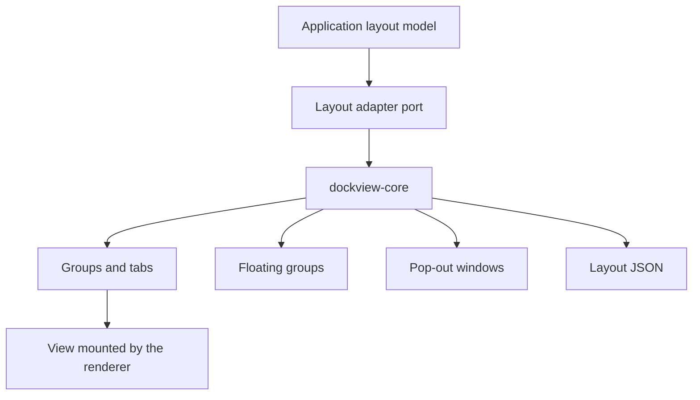

# dockview

dockview is a docking layout library, and this profile covers version 8.8.3 of its `dockview-core` package.

## Overview

dockview arranges panels in tabs, groups, grids and split views. Its core is a zero-dependency TypeScript package[^S71]. The project lists layout serialization, floating groups and pop-out windows as features[^S21]. The dockview project publishes it, and the repository belongs to a GitHub organization of the same name[^S47].

## Architecture

The diagram shows dockview behind a port of ours. The application defines its layout model, and the adapter maps that model to `dockview-core`. A view mounts into a group through the renderer, and `dockview-core` doesn't need to know about React. The [Tessera re-run](experiment-tessera-poc.md) tests this structure.

## Maturity and community

- Version 8.8.3 was published on 2026-10-30[^S36].
- The commit sample has 6 people, and one author made 261 of the 300 commits[^S47].
- The project has a security policy file in its repository (measured with the GitHub API on 2026-11-08).

## Licence and cost

`dockview-core` uses the MIT licence[^S36], so it passes the licence rule of the brief. It is free of charge. The cost is the adapter that we write and test.

## Limits

- One person made most of the commits in the sample[^S47]. This is a bus-factor risk.
- `dockview-core` calls itself an internal package and names `dockview` and `dockview-react` as the packages to install[^S71]. A product should depend on one of those. The proof of concept uses `dockview-core` directly, so it needs this change.
- A popup in a floating group is hidden unless the application sets a stacking rule. The [UI kit experiment](experiment-dockview-ui-kit.md) shows that `isolation: isolate` on the dock host fixes it.
- Pop-out windows use extra browser windows, so an Electron host must allow them explicitly in its window-open handler. The [Electron host experiment](experiment-electron-host.md) denies new windows, so it does not test pop-out windows.

## Fit for us

- **Composable UI and workspaces.** dockview offers docking, floating groups and pop-out windows[^S21].
- **React.** The core does not need React[^S71], and the [Tessera re-run](experiment-tessera-poc.md) renders React views in dockview panels. Radix UI and Base UI both work in those panels, as the [UI kit experiment](experiment-dockview-ui-kit.md) shows.
- **Maintained.** Version 8.8.3 was published on 2026-10-30[^S36]. One person made 261 of the 300 sampled commits[^S47], which is the reason for a replaceable adapter.
- **SOLID.** The adapter port gives dependency inversion. A conformance suite checks that another docking library can replace dockview.

[^S21]: [S21](sources.md#s21) dockview project, dockview README.
[^S36]: [S36](sources.md#s36) dockview project, npm registry entry for dockview-core.
[^S47]: [S47](sources.md#s47) dockview project, GitHub commit list of dockview/dockview.
[^S71]: [S71](sources.md#s71) dockview project, dockview-core package page.
