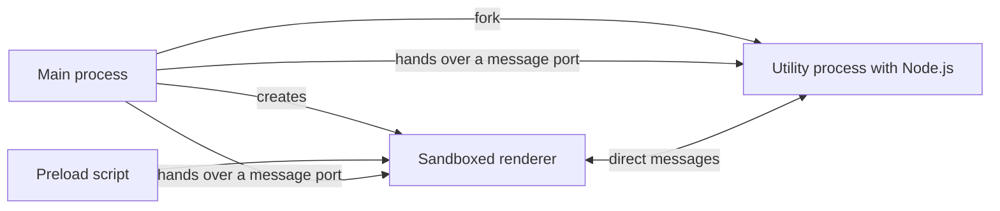

# Electron

This profile covers Electron 45.2.3, a desktop runtime that combines Chromium and Node.js.

## Overview

Electron runs a web UI in Chromium and gives the application Node.js processes. The Electron project publishes it, and version 45.2.3 is the current release[^S34]. VS Code uses Electron for its desktop application[^S9].

## Architecture

The diagram shows the process model that the [Electron host experiment](experiment-electron-host.md) tests. The main process starts a window and a utility process, and it gives each of them one end of a message channel. After that, the renderer talks to the utility process directly. The renderer is sandboxed and has no Node.js environment[^S3]. The utility process has Node.js and message ports[^S2].

## Maturity and community

- The project supports the latest three stable major versions and releases a new major every 8 weeks[^S1].
- Version 45.2.3 was published on 2026-11-04[^S34].
- The commit sample has 34 people, and the top author made 44 of the commits[^S45].
- The security checklist covers context isolation, process sandboxing, IPC sender validation and a Content Security Policy[^S56].

## Licence and cost

Electron uses the MIT licence[^S34], so it passes the licence rule of the brief. It is free of charge.

The brief requires a report on copyleft parts further down the tree. The Chromium licence file of the release has 498 entries. Of those, 17 mention the LGPL, including FFmpeg, and 3 others mention the GPL[^S73]. A legal review should look at these entries before the product goes out.

## Limits

- A new major version every 8 weeks[^S1] means steady upgrade work. An old line loses support quickly.
- Each application includes its own Chromium and Node.js. The [Electron host experiment](experiment-electron-host.md) measures the size.
- A utility process has Node.js[^S2]. The [experiment](experiment-electron-host.md) measured it as not sandboxed by the operating system. It isolates faults and does not contain untrusted code. The brief excludes untrusted plugins from the first release.

## Fit for us

- **Cross-platform.** A packaged build started on Windows x64, Linux x64 and macOS arm64[^S75].
- **React.** The demo rendered React 19 views in its sandboxed renderer on each of those platforms[^S75].
- **Maintained.** The project supports the latest three stable major versions[^S1], and version 45.2.3 was published on 2026-11-04[^S34].
- **SOLID.** One host package can contain every Electron import, which keeps the kernel independent of Electron and follows dependency inversion.

[^S1]: [S1](sources.md#s1) Electron project, Electron Releases.
[^S2]: [S2](sources.md#s2) Electron project, utilityProcess API.
[^S3]: [S3](sources.md#s3) Electron project, Process Sandboxing.
[^S9]: [S9](sources.md#s9) Microsoft, Source Code Organization.
[^S34]: [S34](sources.md#s34) Electron project, npm registry entry for electron.
[^S45]: [S45](sources.md#s45) Electron project, GitHub commit list of electron/electron.
[^S56]: [S56](sources.md#s56) Electron project, Security checklist.
[^S73]: [S73](sources.md#s73) Electron project, LICENSES.chromium.html in the Electron 45.2.3 release.
[^S75]: [S75](sources.md#s75) aade maintainers, GitHub Actions run of the Electron host smoke test.
