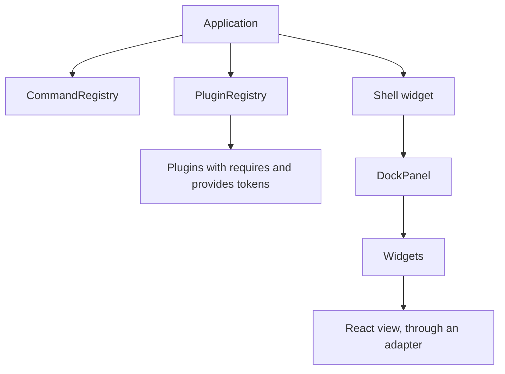

# Lumino

Lumino is the widget and application toolkit of the JupyterLab project, and this profile covers `@lumino/widgets` 2.10.0.

## Overview

Lumino provides widgets, docking, commands and a plugin registry. Project Jupyter publishes it[^S37]. JupyterLab builds on it, and JupyterLab extensions supply nearly every function of that application[^S7].

## Architecture

The diagram shows the main objects. The application contains a command registry, a shell and a plugin registry[^S15]. Plugins declare required, optional and provided tokens, and the registry rejects dependency cycles[^S16]. The shell contains docking panels with widgets. React views need an adapter, because Lumino has no React binding of its own. JupyterLab offers a `ReactWidget` class for this purpose[^S57].

## Maturity and community

- `@lumino/widgets` 2.10.0 was published on 2026-10-08[^S37].
- The commit sample has 4 people, and the top author made 6 of the 34 commits[^S48].
- The repository doesn't contain a security policy file (measured with the GitHub API on 2026-11-08). Whether Project Jupyter covers it elsewhere is unverified.

## Licence and cost

Lumino uses the BSD-3-Clause licence[^S37], so it passes the licence rule of the brief. It is free of charge. The cost is the mechanism that we must add, which the [Lumino demo](experiment-lumino-demo.md) measures at 1,155 lines before hardening.

## Limits

- DockPanel has no floating or pop-out panels[^S17].
- Lumino has no scoped dependency injection, scoped events, workitems or contribution points. The [Lumino demo](experiment-lumino-demo.md) built these itself.
- `Application.commands` is read-only, so a veto layer does not cover commands run through it.
- `Application` has no stop or dispose call.

## Fit for us

- **Dependency injection.** Tokens give flat service lookup[^S16]. Hierarchical scopes are ours to build.
- **Plugins, commands and docking.** These are native[^S15][^S16][^S17]. Lumino also gives menus, a command palette and chord key bindings.
- **React.** It works through an adapter, and the demo rendered Radix components in docked panels.
- **Workspaces and workitems.** These are ours to build.
- **Maintained.** It had a stable release in the last 6 months[^S37], and Project Jupyter backs it.

[^S7]: [S7](sources.md#s7) Project Jupyter, Develop Extensions.
[^S15]: [S15](sources.md#s15) Project Jupyter, Lumino application source.
[^S16]: [S16](sources.md#s16) Project Jupyter, Lumino plugin registry source.
[^S17]: [S17](sources.md#s17) Project Jupyter, Lumino DockPanel source.
[^S37]: [S37](sources.md#s37) Project Jupyter, npm registry entry for @lumino/widgets.
[^S48]: [S48](sources.md#s48) Project Jupyter, GitHub commit list of jupyterlab/lumino.
[^S57]: [S57](sources.md#s57) Project Jupyter, JupyterLab React guide.
