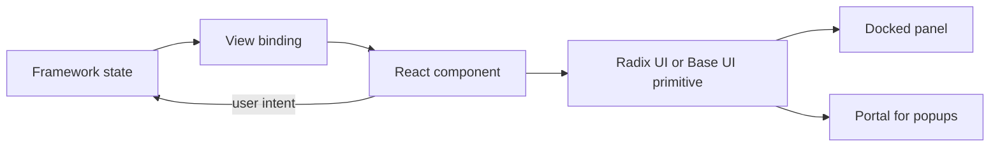

# React and component libraries

This profile covers React 19.3.1, which the brief requires, and the component libraries Radix UI 1.8.1, Base UI 1.9.0 and shadcn/ui.

## Overview

React renders the views of the application. The React team publishes it under semantic versioning[^S24]. Version 19.3.1 is the current release[^S35].

Radix Primitives is an unstyled, accessible component library[^S26]. Base UI gives the same kind of unstyled components in one package[^S27]. shadcn/ui builds styled components on top of these libraries, and its new components are available for Base UI, React Aria and Radix[^S25].

## Architecture

The diagram shows React as the rendering layer only. Framework state flows through one binding into React components. Components use unstyled primitives, and user intents flow back to the framework. Popups render through a portal[^S27], so they leave the DOM subtree of their docked panel. The application must test focus and stacking for this reason.

## Maturity and community

- React had 67 people in the commit sample, and the top author made 49 of the commits[^S46]. Security fixes are backported to every affected major version[^S24].
- Radix had 39 people in the sample, and the top author made 236 of the commits[^S50]. Its last release was on 2026-10-12[^S39].
- Base UI had 29 people in the sample, and the top author made 50 of the commits[^S51]. Its last release was on 2026-10-09[^S40].

## Licence and cost

React 19.3.1, Radix UI 1.8.1 and Base UI 1.9.0 use the MIT licence[^S35][^S39][^S40]. The licence rule of the brief accepts it, and it has no licence fee.

## Limits

- Portals place popups outside their panel[^S27]. A floating dock layer covers them unless the dock host sets `isolation: isolate`, as the [UI kit experiment](experiment-dockview-ui-kit.md) shows. No experiment tested pop-out windows.
- Both primitive libraries come without styles[^S26][^S27], so we must write the styles of our design system.
- One author made 236 of the 285 sampled Radix commits[^S50]. In Base UI the top author made 50 of 300[^S51].

## Fit for us

- **React and modern UI components.** React 19 meets this directly. The [Tessera re-run](experiment-tessera-poc.md) renders React views in docked panels. The [UI kit experiment](experiment-dockview-ui-kit.md) shows Radix UI and Base UI working in dockview panels, and the [Lumino demo](experiment-lumino-demo.md) shows Radix UI working in Lumino panels.
- **Maintained.** All three libraries had a stable release in the last 6 months[^S35][^S39][^S40].
- **Choice between primitives.** We prefer Base UI for a new design system, because its work is spread across more people[^S51]. Radix stays a valid alternative. A thin internal kit keeps the choice replaceable.

[^S24]: [S24](sources.md#s24) React team, Versioning Policy.
[^S25]: [S25](sources.md#s25) shadcn, shadcn/ui changelog.
[^S26]: [S26](sources.md#s26) WorkOS, Radix Primitives introduction.
[^S27]: [S27](sources.md#s27) MUI, Base UI quick start.
[^S35]: [S35](sources.md#s35) React team, npm registry entry for react.
[^S39]: [S39](sources.md#s39) WorkOS, npm registry entry for radix-ui.
[^S40]: [S40](sources.md#s40) MUI, npm registry entry for @base-ui/react.
[^S46]: [S46](sources.md#s46) React team, GitHub commit list of facebook/react.
[^S50]: [S50](sources.md#s50) WorkOS, GitHub commit list of radix-ui/primitives.
[^S51]: [S51](sources.md#s51) MUI, GitHub commit list of mui/base-ui.
